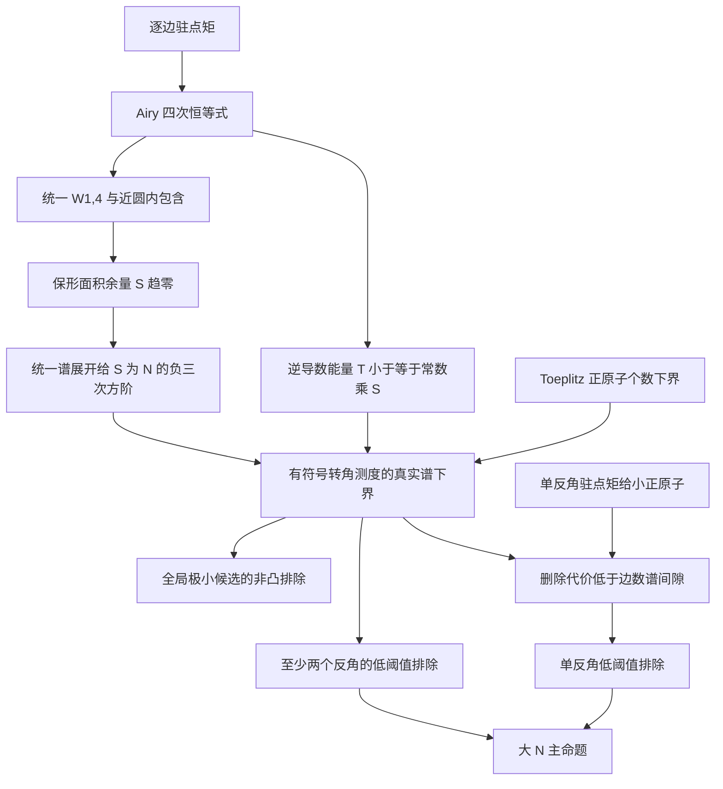

# 大 N 非凸排除证明整编稿

本稿将[第二份对话](https://chatgpt.com/share/6ae5f5c1-73a4-83e8-8ebb-305149ece080)中声称完成的大 N 论证，整理为一条独立的证明链。结论限于边长非零、无自接触、真实内角严格介于 0 与 2π 之间的简单多边形。它是一份研究证明稿；最关键的统一非线性谱引理在第 5 节完整列出，其推导和一致性仍应独立复核。

## 1. 主命题及证明结构

设 P 是恰有 N 条有效边的有界简单多边形。有效边不计相邻共线的冗余节点。记

\[
J(P)=|P|\lambda_1(P),\qquad
m_k=\inf_{\#\mathrm{eff.edges}(Q)\le k}J(Q),
\qquad R_k=\text{正 }k\text{ 边形}.
\tag{1.1}
\]

“驻点”指 J 关于全部原顶点坐标的导数为零，等价于固定面积下 λ₁ 的驻点。

**主命题 A（原对话主张）。** 存在一个与 P 的角度、最小边长、凹角数及预顶点间距无关的 N₀，使得 N≥N₀ 时，普通简单 N 边形若为驻点且

\[
J(P)\le J(R_{N-1}),
\tag{1.2}
\]

则 P 必凸。特别地，不存在 J(P)<m_{N−1} 的此类非凸驻点。

下面把证明分为两个层次：首先排除满足 J(P)≤J(R_N) 的非凸驻点，从而处理普通全局极小候选；再补上单反角的删除引理，得到更强的式 (1.2)。第二层不能省略。

核心尺度是：近圆面积余量 S=O(N⁻³)，非线性谱误差为 O(N⁻⁹ᐟ²√logN)，而少一个凸角造成的比较间隙为正的 N⁻⁴ 阶。误差必须是对全部角度与节点配置一致的，才能得出无几何附加条件的 N₀。

## 2. 驻点条件与 Airy 四次恒等式

### 2.1 每条实际边的两个矩

令 A=|P|、λ=λ₁(P)，u>0 为归一化基态：

\[
-\Delta u=\lambda u,\qquad u\in H_0^1(P),\qquad
\int_Pu^2=1,\qquad c=\lambda/A,
\quad q=|\partial_\nu u|^2.
\]

Hadamard 公式为

\[
DJ(P)[V]=A\int_{\partial P}(c-q)V\cdot\nu\,ds.
\tag{2.1}
\]

原顶点速度在每条实际边上产生仿射法向速度。相邻有效边法向线性独立，故驻点给出逐边

\[
\boxed{\int_E(q-c)ds=0,\qquad
\int_Es(q-c)ds=0.}
\tag{2.2}
\]

s 是该边从任一端点起的物理弧长。归一化到 x∈[0,1]，即 ∫q=c、∫xq=c/2。

### 2.2 校准应力的势函数

采用原对话的半应力记号

\[
\mathbf T=\nabla u\otimes\nabla u
-\tfrac12(|\nabla u|^2-\lambda u^2)I,
\qquad \operatorname{div}\mathbf T=0.
\]

取 Airy 势 ψ 满足 D²ψ=RᵀTR，其中 R 旋转 90°；再令 Φ=ψ−c|x|²/4。其 Hessian 为

\[
D^2\Phi=\tfrac12(|\nabla u|^2+\lambda u^2-c)I
-\nabla u\otimes\nabla u.
\tag{2.3}
\]

在开边上 Φₜₜ=(q−c)/2、Φνₜ=0。由第一矩中的零阶式，∇Φ 在一条边两端相同，沿所有边传播后可减去一个仿射函数，使它在全部顶点为零。因此 ∂νΦ=0 于全部开边。

角点内角 ω<2π，α=π/ω>1/2，基态首模态为 arᵅsin(αθ)。所以 |∇u|⁴=O(r⁴ᵅ⁻⁴) 在二维可积，切去小角弧后的二阶散度余项也趋零。利用

\[
\operatorname{div}\{\Delta\Phi\nabla\Phi-D^2\Phi\nabla\Phi\}
=(\Delta\Phi)^2-|D^2\Phi|^2,
\]

以及边上 ∂νΦ=0、混合 Hessian 项为零，得到 Hessian 行列式积分为零。D²Φ 的特征值是 (λu²−c±|∇u|²)/2，故

\[
\boxed{\int_P|\nabla u|^4
=\lambda^2\left(\int_Pu^4-A^{-1}\right).}
\tag{2.4}
\]

这条恒等式没有使用近圆性，也没有限制凹角数量。

### 2.3 几何无关的正则性

热核估计给 ∥u∥∞²≤e²λ/(8π)。式 (2.4) 因而推出

\[
\int_P|\nabla u|^4\le\frac{e^2\lambda^3}{8\pi}.
\tag{2.5}
\]

当面积固定、λ 有界时，零延拓的 u 在全平面统一有 W¹,⁴ 界及 C⁰,¹ᐟ² 界。这里各 P 的角点虽可任意接近退化值，但估计常数不使用角度下界。

## 3. 保形归一化及低能推出 S 等于 N⁻³ 阶

### 3.1 最大保形半径规范

以最大保形半径点为 Riemann 映射中心，再缩放和旋转，使

\[
F:\mathbb D\to P,\qquad F'(0)=1,\quad F''(0)=0.
\tag{3.1}
\]

第二个等式来自最大保形半径的一阶临界条件：圆盘参数 a 下，保形半径是 (1−|a|²)|F′(a)|，在 a=0 微分即得 F″(0)=0。

记

\[
f=F'=1+g,\quad g(z)=\sum_{n\ge2}g_nz^n,
\qquad
S=\|g\|_{A^2}^2=\frac1\pi\int_{\mathbb D}|g|^2
=\sum_{n\ge2}\frac{|g_n|^2}{n+1}.
\tag{3.2}
\]

面积公式精确给出 A=π(1+S)。以下以

\[
\mathcal J(P)=\frac{J(P)}{\pi j^2},\qquad j=j_{0,1},
\tag{3.3}
\]

表示相对于圆盘的无量纲谱值。J 和 S 都不受最初整体缩放的影响。

### 3.2 先证明 S 趋零，再使用小 S 展开

由式 (1.2) 及正多边形渐近，面积归一化为 π 后 λ(P)−j²=O(N⁻³)。定量 Faber–Krahn 给平移后 |P△D|→0。

这一面积收敛本身不排除裂缝；这里使用第 2 节的驻点 W¹,⁴ 界。基态在固定紧集上子列一致收敛；由统一 L∞ 界，圆盘外 L² 质量趋零。极限属于 H₀¹(D)、L² 范数为 1、能量不超过 j²，故只能为圆盘归一化正基态 u₀。

于是任意 η>0，最终 B₁₋η⊂P。否则取缺失点 x_N∈B₁₋η\P，零延拓 u_N(x_N)=0，与 u₀ 在该闭圆盘严格正及一致收敛矛盾。

面积 π 规范下，最大保形半径 r_P 至少为 1−η，至多为 1。换到式 (3.1) 的规范，1+S=r_P⁻²，因此 S→0。这个顺序避免了先用小 S 展开反过来假定 S 已小的循环。

### 3.3 统一小 S 谱展开

令 v=u∘F，圆盘上满足

\[
-\Delta v=\lambda|1+g|^2v,\quad v|_{\partial D}=0,
\quad\int_Dv^2|1+g|^2=1.
\tag{3.4}
\]

在零边界迹的 C¹ 范数空间 X 中，设 d(z)=1−|z|，则 |h(z)|≤d(z)∥h∥X。圆盘 Dirichlet Green 算子满足

\[
\|\mathcal G(gh)\|_X\le C\|g\|_{A^2}\|h\|_X,
\qquad
\|\mathcal G(g_1\overline{g_2}h)\|_X
\le C\|g_1\|_{A^2}\|g_2\|_{A^2}\|h\|_X.
\tag{3.5}
\]

**估计的证明。** 固定 x，令 δ=d(x)。近区 |x−z|<δ/2，Bergman 点值界给 |gᵢ(z)|≤C∥gᵢ∥/δ，|h|≤Cδ∥h∥X，梯度 Green 核≤C/|x−z|，积分后得到所需常数。远区梯度核≤Cd(z)/|x−z|²，而 d(z)≤δ+|x−z|≤3|x−z|，故连同 h 的消失因子后权重有界。对 g₁g₂ 用 L² Cauchy–Schwarz，对 g 用 L¹≤CL² 即得。值函数本身由零边界及梯度控制。多项式逼近保持该算子界，从而得到连续边界导数。

因此 K_g=G[|1+g|²·] 是 A² 上有界的实二次算子族，∥K_g−K₀∥≤C(√S+S)。圆盘基态简单，解析扰动给出

\[
v=v_0+v_1+v_2+O_X(S^{3/2}),
\qquad \|v_1\|_X\le C\sqrt S,\quad \|v_2\|_X\le CS.
\tag{3.6}
\]

常数只来自固定圆盘的算子界和谱隙。所得谱分支确实是第一特征值：v₀≥cd(z)，而 C¹ 小扰动及零边界迹给 |v−v₀|≤C√S d(z)，所以该分支的状态函数严格正。正特征函数只能对应第一模态。

定义

\[
\rho_n=j\frac{J_{n+1}(j)}{J_n(j)},\qquad
\beta_n=n+1-\rho_n,\qquad p_D=j/\sqrt\pi.
\tag{3.7}
\]

单模态 g_nzⁿ 的一阶响应是

\[
(v_1)_n=
\frac{r^{n+1}v_0'(r)+p_DJ_n(jr)/J_n(j)}{n+1}
\operatorname{Re}(g_ne^{in\theta}).
\tag{3.8}
\]

为明确二阶系数，取实单模态 g=tazⁿ，写 v₁=awₙ(r)cos(nθ)。二阶可解条件给

\[
\frac{\lambda_2}{j^2a^2}
=-2\pi\int_0^1\{r^{2n+1}v_0^2+r^{n+1}v_0w_n\}dr.
\]

代入式 (3.8)，含 v₀v₀′ 的项经分部积分恰好抵消第一项。剩下的 Bessel 径向积分为

\[
\int_0^1r^{n+1}v_0(r)J_n(jr)dr
=\frac{J_{n+1}(j)}{2\sqrt\pi(n+1)},
\]

由 Bessel 方程、递推与 v₀(1)=0 分部积分得到。因此 λ₂/(j²a²)=−ρₙ/(n+1)²。不同模态正交，加上面积因子 1+S，得到实际谱展开

\[
\boxed{\mathcal J(P)
=1+S-\sum_{n\ge2}\frac{\rho_n}{(n+1)^2}|g_n|^2
+O(S^{3/2}).}
\tag{3.9}
\]

Bessel 递推给 0<ρ_n<2，故 β_n≥n−1，二次型至少为 S/3。缩小统一小 S 范围后，有 Jcal−1≥S/6。结合此前已证明 S→0 及低谱上界，得到

\[
\boxed{S\le CN^{-3}.}
\tag{3.10}
\]

从现在起，所有 O(S³ᐟ²√log(e/S)) 余项均为 o(N⁻⁴)。

## 4. 用驻点恒等式控制逆保形导数

### 4.1 逆导数的 Bergman 能量

令

\[
k=f^{-1}-1,\qquad T=\|k\|_{A^2}^2.
\tag{4.1}
\]

f 在 D 内不为零。反角的 SC 权重为 −v、0<v<1/2，局部 f∼(z−ζ)²ᵛ，所以 |f⁻¹|² 的二维积分有限。故每个普通多边形的 T 有限，但尚无统一上界。

将式 (2.4) 拉回圆盘，得到

\[
\int_D|\nabla v|^4|1+k|^2
=\lambda^2\int_Dv^4|1+g|^2
-\frac{\lambda^2}{\pi(1+S)}.
\tag{4.2}
\]

记 a(r)=|∇v₀(r)|⁴，b₁=4|∇v₀|²∇v₀·∇v₁。式 (3.6) 给 |∇v|⁴=a+b₁+O(S)。径向 a 与解析零常数项 k 正交，且 b₁ 的圆周均值为零，于是左边为

\[
\int_Da+\int_Da|k|^2
+O(\sqrt S\sqrt T+\sqrt S\,T+S(1+T)).
\tag{4.3}
\]

右边的一阶项也因 Fourier 正交消失，等于 ∫a+O(S)。a 在一个固定外环上有正下界；内圆盘上 g=O(√S)，故 k=−g/(1+g)=O(√S)。因此

\[
T\le C\{S+\sqrt S\sqrt T+\sqrt S\,T+ST\}.
\]

用 Young 不等式控制 √S√T，并在 S 足够小时吸收另外两项，得到

\[
\boxed{T\le CS.}
\tag{4.4}
\]

这一推导不要求负转角总量小，也不要求反角与 2π 保持统一距离。

### 4.2 对数能量的正确单侧比较

令 L=logf，取 L(0)=0。由解析函数均值性质，S+T=π⁻¹∫(|f|²+|f⁻¹|²−2)。又

\[
|f|^2+|f^{-1}|^2-2
=2\cosh(2\operatorname{Re}L)-2
\ge4(\operatorname{Re}L)^2.
\]

L 的常数项为零，故其实名与虚部的 Bergman 能量相等，从而

\[
\boxed{\|L\|_{A^2}^2\le(S+T)/2.}
\tag{4.5}
\]

这里只是单侧不等式。不能把 f−1 与 logf 在普通 A² 范数中直接视为误差足够小的同一变量。

## 5. 核心统一非线性谱下界

本节是整条大 N 论证最关键的谱引理：需要将式 (3.9) 中 f−1 的二次型，转成真实 SC 对数转角的正二次型，并把误差控制到 o(N⁻⁴)。以下保留原对话的推导。

### 5.1 一个带频率衰减的替换引理

设 D₁=g+k=−gk。由式 (4.4)，有 ∥D₁∥A¹≤CS、∥D₁∥A²²≤CS。解析系数公式给 |(D₁)ₙ|≤C(n+1)S。在 K=S⁻¹ᐟ² 处分频，得到

\[
\sum_{n\ge2}\frac{|(D_1)_n|^2}{(n+1)^3}
\le CS^2\log(e/S).
\tag{5.1}
\]

低频用系数界后求和 Σₙ≤K1/n，高频以 K⁻²∥D₁∥A²² 控制。于是对任何 |bₙ|≤C/(n+1)²，Cauchy–Schwarz 给

\[
\left|\sum_{n\ge2}b_n(|k_n|^2-|g_n|^2)\right|
\le CS^{3/2}\sqrt{\log(e/S)}.
\tag{5.2}
\]

原因是 |kₙ|²−|gₙ|² 的实部分可写成 (kₙ+gₙ) 与 kₙ−gₙ 的乘积，两个因子分别使用 (n+1)⁻³ 与 (n+1)⁻¹ 权重。

对 D₂=L−g 也有同样估计：初等指数余项界与式 (4.5) 给 ∥D₂∥A¹≤CS，而三角不等式给 ∥D₂∥A²²≤CS。因此所有 O(n⁻²) 乘子的二次型，都可把 g 换成 L，误差同为

\[
\mathcal E(S):=S^{3/2}\sqrt{\log(e/S)}.
\tag{5.3}
\]

### 5.2 把正、逆导数暂作为独立变量

定义实际圆盘谱状态对应的泛函

\[
\mathscr H(g,k)=
\int_D|\nabla v(g)|^4|1+k|^2
-\lambda(g)^2\int_Dv(g)^4|1+g|^2
+\frac{\lambda(g)^2}{\pi(1+\|g\|_{A^2}^2)}.
\tag{5.4}
\]

把 g、k 看成两个独立的解析 Bergman 变量。式 (3.5)–(3.6) 使它是固定邻域上的实解析泛函，零阶、一阶项均为零。实际驻点满足 H(g,k)=0。

其二阶项中，先精确抽出 πp_D⁴(T−S)。剩余含 k 的项只有

\[
\int_D(a(r)-p_D^4)|k|^2
+2\int_Db_1(g)\operatorname{Re}k.
\tag{5.5}
\]

第一项因 a(1)=p_D⁴，其径向模态乘子为 O(n⁻²)；第二项将式 (3.8) 代入径向积分后，混合乘子为 O(n⁻³)。因此式 (5.2) 允许在这些项中把 k 换成 −g。注意：πp_D⁴T 的乘子只有 O(n⁻¹)，这一主项不能同样替换，必须保留。

### 5.3 单模态算出完整的二阶系数

先取光滑多项式方向 F_t′=1+tazⁿ，n≥2。式 (3.8) 给物理边界通量的一阶变化

\[
\delta(q-c)=-\frac{2p_D^2\beta_n}{n+1}
\operatorname{Re}(ae^{in\theta}).
\tag{5.6}
\]

令 G=∇Φ。沿一般光滑边界仍有 dG/ds=(q−c)t/2；圆盘上 G 可取零。若式 (5.6) 的实余弦振幅为 dₙ，则一阶 G 的两个复 Fourier 频率为 n+1 与 1−n，其梯度像有向面积为

\[
-\frac{\pi d_n^2}{8(n^2-1)}.
\]

另一方面，H=−4∫detD²Φ，即该面积的 −4 倍。故单模态二阶系数为

\[
2\pi p_D^4
\frac{\beta_n^2}{(n+1)^2(n^2-1)}|a|^2.
\tag{5.7}
\]

不同模态因旋转正交性不交叉。对多项式方向先计算，再由二次型连续性推广；连同式 (5.5) 的加权替换和 H=0，得到

\[
\boxed{S-T=2\sum_{n\ge2}
\frac{\beta_n^2}{(n+1)^2(n^2-1)}|g_n|^2
+O(\mathcal E(S)).}
\tag{5.8}
\]

这里没有在整个 Bergman 小球上对 f⁻¹ 作 Taylor 展开。被展开的是双变量泛函，逆关系只用于式 (5.1)–(5.2)。

### 5.4 得到对数转角的正二次型

式 (4.5) 等价于 S≥∥L∥A²²+(S−T)/2。把式 (5.8) 代入式 (3.9)，再仅在具有 O(n⁻²) 衰减的余下二次型中将 g 换成 L，得到

\[
\boxed{\mathcal J(P)\ge
1+\sum_{n\ge2}\gamma_n|L_n|^2-C\mathcal E(S),}
\tag{5.9}
\]

\[
\gamma_n=\frac{\beta_n}{(n+1)^2}
\left(1+\frac{\beta_n}{n^2-1}\right)>0.
\tag{5.10}
\]

取 SC 转角权重及其有符号测度

\[
w_i=\frac{\pi-\omega_i}{2\pi},\qquad
\mu=\sum_{i=1}^Nw_i\delta_{\theta_i},
\quad \widehat\mu(n)=\sum_iw_ie^{-in\theta_i}.
\]

由于总转角为 2π、F″(0)=0，

\[
\sum_iw_i=1,\qquad \widehat\mu(1)=0,
\qquad
f(z)=\prod_i(1-e^{-i\theta_i}z)^{-2w_i},
\quad L_n=2\widehat\mu(n)/n.
\tag{5.11}
\]

所以核心谱引理最终写成

\[
\boxed{\mathcal J(P)\ge
1+4\sum_{n\ge2}a_n|\widehat\mu(n)|^2-C\mathcal E(S),
\quad
a_n=\frac{\beta_n}{n^2(n+1)^2}
\left(1+\frac{\beta_n}{n^2-1}\right).}
\tag{5.12}
\]

原对话主张：这里小 S 邻域及 C 均不依赖凹角个数、负转角总量、角度或预顶点间距。第 9 节的所有无条件大 N 结论，都依赖这一致性成立。

## 6. 有符号原子的个数下界

### 6.1 Toeplitz 压缩引理

设 μ 是总质量为 1 的有限实原子测度，恰有 p 个正权原子，允许负权且无需控制负权总量。对 0<τ<1，

\[
\boxed{\sum_{n\ge1}\tau^n|\widehat\mu(n)|^2
\ge\frac{\tau^p}{1-\tau^p}.}
\tag{6.1}
\]

**证明。** 在 ℓ²(N₀) 上定义有限秩自伴算子

\[
A_{rs}=\tau^{(r+s)/2}\widehat\mu(r-s)
=\sum_iw_i(v_i)_r\overline{(v_i)_s},
\qquad (v_i)_r=\tau^{r/2}e^{-ir\theta_i}.
\]

不同节点的 Vandermonde 矩阵可逆，故 A 恰有 p 个正特征值 α₁≥⋯≥α_p>0。记正谱和 Q=Σαᵢ，则 Q≥TrA=1/(1−τ)。单边移位 U 满足 U*AU=τA，余维一压缩的特征值交错给 αᵢ₊₁≤ταᵢ。

因此 αᵢ/τⁱ⁻¹ 递减；与等和几何序列 bᵢ=Q(1−τ)τⁱ⁻¹/(1−τᵖ) 比较，其每个前缀和都不小于 b 的前缀和。分部求和，利用 αᵢ+bᵢ 递减，得

\[
\sum_i\alpha_i^2\ge\sum_ib_i^2
=Q^2\frac{1-\tau}{1+\tau}\frac{1+\tau^p}{1-\tau^p}.
\]

而按矩阵元素直接求和，

\[
\|A\|_{HS}^2=
\frac{1+2\sum_{n\ge1}\tau^n|\widehat\mu(n)|^2}{1-\tau^2}.
\]

总 Hilbert–Schmidt 范数不小于正特征值平方和。代入 Q≥1/(1−τ) 即得式 (6.1)。有负原子时 Q 严格大于迹，但后面只需要非严格式。∎

### 6.2 选择一个可作正积分的显式核

采用最后一轮对话给出的改进核。令

\[
\kappa=j^2/2-1,\qquad
b_n=\frac1{n(n^2+\kappa)}.
\tag{6.2}
\]

则对所有 n≥2，有 0<bₙ≤aₙ。

**核比较的证明。** Bessel 交错级数给 5.78<j²<5.8，故 1.89<κ<1.9。令 α=j²/2=κ+1。递推给

\[
0<\rho_n<\frac6{2n-1}\le2,
\quad
\rho_n=\frac\alpha{n+1-\rho_{n+1}/2}
\le\frac\alpha{n+1-\alpha/[2(n+1)]}.
\]

直接化简式 (5.12) 中的系数：

\[
a_n=\frac{n-\rho_n+\rho_n^2/(n+1)^2}{n^2(n^2-1)}.
\tag{6.3}
\]

n≥3 时，κ<n−nα/[2(n+1)]，从而 ρₙ<nα/(n²+κ)。舍去式 (6.3) 的正平方项，即得 aₙ≥1/[n(n²+κ)]。n=2 时，由 J₀(j)=0，β₂=κ，a₂=κ(κ+3)/108。所需不等式等价于 κ³+7κ²+12κ−54≥0，在 κ≥1.89 时成立。∎

新核有非负 Laplace 表示

\[
b_n=\int_0^\infty e^{-nt}w(t)dt,
\qquad w(t)=\frac{1-\cos(\sqrt\kappa t)}\kappa,
\quad 0\le w(t)\le t^2/2.
\tag{6.4}
\]

令 E_b(μ)=Σₙ≥₁bₙ|μhat(n)|²。将式 (6.1) 对正权 w(t) 积分，Tonelli 定理给

\[
\boxed{E_b(\mu)\ge B_p,\qquad
B_p=\sum_{\ell\ge1}\frac1{\ell p((\ell p)^2+\kappa)}.}
\tag{6.5}
\]

其精确下界和单调性是

\[
B_p\ge\frac{\zeta(3)}{p^3}-\frac{\kappa\zeta(5)}{p^5},
\qquad B_p\text{ 随 }p\text{ 严格递减}.
\tag{6.6}
\]

第一式逐项使用 (1+x)⁻¹≥1−x。由于原转角测度 μhat(1)=0，式 (5.12) 可进一步减弱成

\[
\boxed{\mathcal J(P)\ge1+4E_b(\mu)-C\mathcal E(S)
\ge1+4B_p-C\mathcal E(S).}
\tag{6.7}
\]

这里 p 就是 P 的凸角个数。这个“数凸角而不数全部顶点”的下界，是大 N 非凸排除的离散输入。

## 7. 首先排除普通非凸全局极小候选

正多边形的已知渐近是

\[
\mathcal J(R_M)=1+\frac{4\zeta(3)}{M^3}+O(M^{-5}).
\tag{7.1}
\]

其中 M⁻⁴ 项为零；参见 [Berghaus–Georgiev–Monien–Radchenko 的定理与系数表](https://arxiv.org/pdf/2103.01057)。这一零系数对于下面的 N⁻⁴ 间隙比较很重要。

若 P 非凸，则凸角个数 p≤N−1。假设 P 驻定且 J(P)≤J(R_N)。由式 (3.10)、(6.6)–(6.7)，

\[
\begin{aligned}
\mathcal J(P)&\ge
1+\frac{4\zeta(3)}{(N-1)^3}
-\frac{4\kappa\zeta(5)}{(N-1)^5}
-CN^{-9/2}\sqrt{\log N},\\
\mathcal J(P)&\le
1+\frac{4\zeta(3)}{N^3}+O(N^{-5}).
\end{aligned}
\tag{7.2}
\]

但

\[
4\zeta(3)\{(N-1)^{-3}-N^{-3}\}
=12\zeta(3)N^{-4}+O(N^{-5}),
\tag{7.3}
\]

严格压过全部 o(N⁻⁴) 误差，N 足够大时矛盾。

因此，在核心谱引理的一致性成立的前提下，普通简单多边形类中，充分大 N 的非凸驻点不可能满足 J(P)≤J(R_N)。普通的 N 边全局极小候选是驻点，并且可与 R_N 比较，所以它必凸。此处没有假设 R_N 已经在非凸类中最优。

## 8. 单反角的附加引理

第 7 节还不能直接处理 J(P)≤J(R_{N−1})：若只有一个反角，p=N−1，原子个数下界和参考 R_{N−1} 的首项相同，尚无 N⁻⁴ 正间隙。本节从真实驻点矩中找出一个足够小的正原子，再把它从离散比较中删除。

### 8.1 每条预顶点弧都足够短

F−F(0)−z 的边界齐次 H¹ᐟ² 半范数精确对应 S。若一条预顶点弧 I 长为 ε，其像 F(I) 是直线，则对该直线的单位法向 n，有

\[
n\cdot(F(e^{i\theta})-e^{i\theta})
=\text{常数}-n\cdot e^{i\theta}.
\]

把圆周 H¹ᐟ² 双积分限制到 I×I。对任意方向 n，余弦曲线在小弧上有非零的一阶或二阶变化，故局部半范数平方至少为 cε⁴。更具体地，若弧中点的一阶导数不小，则得到更强的 cε²；否则二阶导数保持非零，缩放后给 cε⁴。若 ε 不小，先限制到固定短子弧便得到 S 的固定正下界。

所以 S→0 时，最大预顶点间距满足

\[
\boxed{\Delta\le CS^{1/4}.}
\tag{8.1}
\]

这只是上界，不要求最小间距。

### 8.2 圆盘边界导数的局部振荡

记 p(θ)=−∂ᵣv(eⁱθ)。式 (3.6)–(3.8) 给 p=p_D+p₁+R，∥R∥∞≤CS。一阶部分的第 n 个 Fourier 乘子为 O(n⁻²)。因此对任意长度 ε 的弧，Cauchy–Schwarz 给

\[
\operatorname{osc}_I p
\le C\left[\sqrt S\,\varepsilon\sqrt{\log(e/\varepsilon)}+S\right].
\tag{8.2}
\]

这里用到 Σₙ≥₂min(n²ε²,4)/n³≤Cε²log(e/ε)。结合式 (8.1)，每条实际边对应弧上均有

\[
\operatorname{osc}_Ip\le C\eta,
\qquad
\eta=S^{3/4}\sqrt{\log(e/S)}.
\tag{8.3}
\]

p 还有统一正下界，因为 ∥p−p_D∥∞≤C√S。

### 8.3 唯一反角保证一条可控制的混合边

将唯一负原子放在 θ=0，权重为 −v，其他权重 aⱼ>0。令 ℓ(θ)=log|f(eⁱθ)|，x=cot(θ/2)、xⱼ=cot(θⱼ/2)。SC 公式给

\[
\ell'(\theta)=vx+C_*+
\sum_j\frac{a_j(1+x_j^2)}{x-x_j},
\qquad C_*=\sum_ja_jx_j.
\tag{8.4}
\]

若 C*≥0，选反角右侧的第一条边；若 C*≤0，选左侧。由式 (8.1)，弧长最终小于 π。在右侧弧上 x>0 且 x>xⱼ，式 (8.4) 各项非负；左侧各项非正。故适当定向后 h=|f| 严格单调。

设选中边的正端点质量为 a。保留式 (8.4) 中负端点和该正端点的项，在中央半弧用 cot 的初等差商界积分，可得

\[
\Delta_{mid}\ell\ge c(a+v).
\tag{8.5}
\]

常数不依赖该弧的长短。其余正项没有被作为误差舍去，因而不需要预顶点分离条件。

### 8.4 两矩把几何单调性变成小原子

反转参数使 h 在 (0,ε) 上递减，定义

\[
\mathsf A=\int_{s<t}\frac{h(s)}{h(t)}dsdt,
\qquad
\mathsf B=\int_{s<t}\frac{h(t)}{h(s)}dsdt.
\]

有 B≤ε²/2。以左右四分之一弧组成的矩形控制 A−B，得 A−B≥cε²sinh(Δ_midℓ)。因此

\[
D:=\frac{\mathsf A-\mathsf B}{\mathsf A+\mathsf B}
\ge c\min(\Delta_{mid}\ell,1)\ge c(a+v).
\tag{8.6}
\]

令 x∈[0,1] 为归一化物理弧长、k₀=h⁻²。换元可验证

\[
D=\frac{2\int_0^1(x-1/2)k_0(x)dx}{\int_0^1k_0(x)dx}.
\]

物理平方通量为 q=p²k₀，而式 (2.2) 给 ∫(x−1/2)p²k₀=0。将 p² 与其最大、最小值的中点比较，得到

\[
D\le\frac{\max_Ip^2-\min_Ip^2}{\max_Ip^2+\min_Ip^2}
\le C\operatorname{osc}_Ip.
\tag{8.7}
\]

结合式 (8.3)、(8.5)–(8.7)，

\[
\boxed{a+v\le C\eta,
\qquad a\le CN^{-9/4}\sqrt{\log N}.}
\tag{8.8}
\]

得到小的相邻正原子，是本节真正需要的结论。小原子尚未被从实际多边形中删除，下面只在离散能量比较中删除。

## 9. 阈值矛盾与大 N 主命题

现在假设 P 驻定且满足式 (1.2)，并反设非凸。

### 9.1 至少两个反角

此时凸角个数 p≤N−2。式 (6.7) 给

\[
\mathcal J(P)\ge1+\frac{4\zeta(3)}{(N-2)^3}-o(N^{-4}).
\tag{9.1}
\]

而 J(P)≤J(R_{N−1}) 给上界 1+4ζ(3)/(N−1)³+O(N⁻⁵)。两者相差正的 N⁻⁴ 主项，矛盾。因此只剩单反角。

### 9.2 单反角的能量缺口控制势函数

此时 p=N−1。记

\[
\delta=E_b(\mu)-B_p\ge0.
\]

由低谱上界、式 (6.6)–(6.7)，

\[
\delta\le CN^{-9/2}\sqrt{\log N},\qquad E_b(\mu)=O(N^{-3}).
\tag{9.2}
\]

定义核势

\[
U_b(\theta)=\sum_{n\ge1}b_n
\operatorname{Re}(\widehat\mu(n)e^{in\theta}).
\]

令 E(t)=Σe⁻ⁿᵗ|μhat(n)|²、E₀(t)=1/(eᵖᵗ−1)。式 (6.1) 给 E≥E₀，且 δ=∫w(E−E₀)。Fourier Cauchy–Schwarz 和式 (6.4) 给

\[
|U_b(\theta)|\le\int_0^\infty
w(t)\sqrt{\frac{E(t)}{e^t-1}}dt.
\]

将 √E≤√(E−E₀)+√E₀ 分开。第一项≤C√δ，因为 ∫w/(eᵗ−1) 有限；第二项利用 w≤t²/2、eᵗ−1≥t，再作 s=pt 换元，至多 Cp⁻⁵ᐟ²。因此

\[
\boxed{\|U_b\|_\infty\le C\sqrt\delta+Cp^{-5/2}.}
\tag{9.3}
\]

### 9.3 删除一个小正原子

取式 (8.8) 的正原子 aδθ*，定义总质量仍为 1 的有符号测度

\[
\widetilde\mu=\frac{\mu-a\delta_{\theta_*}}{1-a}.
\tag{9.4}
\]

记 K_b(0)=Σbₙ<∞，直接展开得精确恒等式

\[
E_b(\widetilde\mu)-E_b(\mu)
=\frac{2a(E_b(\mu)-U_b(\theta_*))
+a^2(K_b(0)-E_b(\mu))}{(1-a)^2}.
\tag{9.5}
\]

式 (8.8)、(9.2)–(9.3) 因而给

\[
\boxed{|E_b(\widetilde\mu)-E_b(\mu)|
\le CN^{-9/2}\log N=o(N^{-4}).}
\tag{9.6}
\]

删除后正原子恰为 N−2 个，所以 E_b(μtilde)≥B_{N−2}。μtilde 不必满足一阶 Fourier 中心化，也不必对应实际多边形：式 (6.5) 对全部总质量 1 的有符号测度成立，而 E_b 保留了全部 n≥1 模式。实际谱下界只对原 P、原 μ 使用。

因此从式 (6.7) 再得

\[
\mathcal J(P)\ge1+4B_{N-2}-o(N^{-4})
\ge1+\frac{4\zeta(3)}{(N-2)^3}-o(N^{-4}),
\]

同样与 J(P)≤J(R_{N−1}) 矛盾。

两种反角数量均被排除。由此，若第 3、5 节的统一谱估计及其推导成立，就得到主命题 A，且 N₀ 无需依赖任何局部角度或预顶点分离参数。

## 10. 从驻点不存在得到精确保面积下降

设 N≥N₀，P 为普通非凸 N 边形，J(P)<m_{N−1}。因为 m_{N−1}≤J(R_{N−1})，主命题说明 P 不是面积驻点。

以原顶点组成坐标向量 X，面积为 A(X)，定义面积切向的特征值梯度

\[
Z=\nabla\lambda_1(X)
-\frac{\nabla\lambda_1(X)\cdot\nabla A(X)}{|\nabla A(X)|^2}\nabla A(X).
\tag{10.1}
\]

非驻点保证 Z≠0。取 V=−Z，有 A′(X)V=0、λ′(X)V=−|Z|²<0。定义

\[
X(t)=\sqrt{\frac{A(X)}{A(X+tV)}}(X+tV).
\tag{10.2}
\]

该路径精确保持面积，且 X′(0)=V，故 λ′(0)=−|Z|²<0。足够小 t 保持单纯性和全部有效边。

这是一条真正不增加边数的下降路径。它是在证明候选非驻定之后构造的，不能在已假设驻定的点上再宣称存在负的一阶面积保持导数。

## 11. 结论范围与必须核验的接口

### 11.1 这条证明链声称到达的结论

主命题排除的是大 N 普通简单多边形中的全部低阈值非凸驻点；普通全局极小候选的非凸排除由第 7 节已先行得到。它不要求先知道正 N 边形在所有简单多边形中最优。

它没有覆盖 N<N₀，也没有给出 N₀ 的有效数值；没有处理闭包中的连通自接触、零角、2π 裂缝角。接触构型的允许速度可能受不穿越约束，其极小性只给变分不等式，不能直接使用全部逐边等式 (2.2)。因此“普通候选必凸”不能直接替换成“包含所有退化闭包构型的优化问题已经解决”。

### 11.2 本稿中最需要独立复核的地方

| 接口 | 需要核对的内容 | 失败会影响的结论 |
|---|---|---|
| 式 (3.5)–(3.9) | Green 算子在固定零迹 C¹ 空间上的有界性、解析谱分支与真实第一特征值的识别、单模态系数和统一余项 | S 的定量阶及全部尖锐谱比较 |
| 式 (5.5)–(5.8) | 双变量四次泛函的二阶展开、O(n⁻²)／O(n⁻³) 混合乘子计算、从多项式方向到 A² 的连续推广 | 不控制凹角数与节点间距的核心谱下界 |
| 式 (8.1)–(8.8) | 直边弧的 H¹ᐟ² 下界、唯一反角 cot 场选边、质心不等式的统一常数 | 比全局极小者排除更强的单反角低阈值结论 |

Toeplitz 原子个数引理、正核比较和原子删除的代数已在正文展开；它们不能替代上表中的实际谱分析。原对话把整体标为大 N 已证，本稿保留这一主张的完整论证，同时将其最强的一致性接口显式呈现，供逐项复核。

### 11.3 来源与补充安排

主线来自[分享对话](https://chatgpt.com/share/6ae5f5c1-73a4-83e8-8ebb-305149ece080)中倒数第二次证明回复；正核采用最后一次回复的改进形式。原始可见消息编号只在核对资料包中使用：L091 提供 Toeplitz 完整证明，L105 提供单反角局部压力和 cot 场推导，L111 提供整体大 N 链条，L113 提供有理核改进及范围说明。

本稿将原文的近圆规约改按“驻点四次恒等式 → 统一 W¹,⁴ → 内圆包含 → S→0”排列；并将最后一轮的正核代入单反角删除步骤。所需性质是核的正 Laplace 表示及 w(t)≤Ct²，正文已写明，未把换核视为无须论证的替换。

外部输入仅包括标准保形与角点理论、简单谱解析扰动、[锐定量 Faber–Krahn](https://arxiv.org/abs/1306.0392)以及[正多边形谱渐近](https://arxiv.org/abs/2103.01057)。本稿没有使用仅在凸类成立的大边数最优性结果来反过来证明非凸排除。

