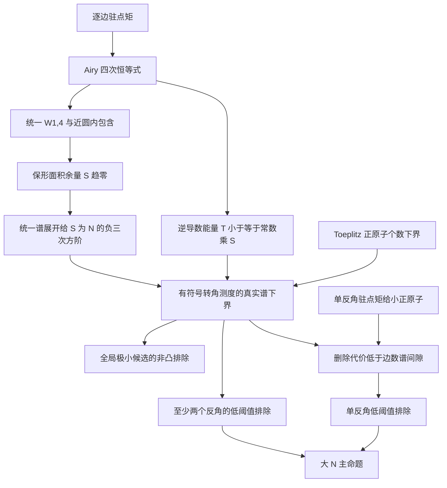

# 大 N 非凸排除待审详细证明稿

本稿将[第二份对话](https://chatgpt.com/share/6ae5f5c1-73a4-83e8-8ebb-305149ece080)中声称完成的大 N 论证，整理为一条连续的详细证明链。第 5、8 节已补写乘子、余项、模态面积、弧长及驻点矩的具体推导；第 2.4、3.4 节补写它们依赖的分析入口。本稿仍是待审研究证明稿，尚未经独立核验。第 11 节逐项区分原文省略点、本次新增推导、标准外部输入和仍未覆盖的结论。主命题范围限于边长非零、无自接触、有效内角严格介于 0 与 2π 之间的普通简单多边形。

## 1. 主命题及证明结构

设 P 是恰有 N 条有效边的有界简单多边形。有效边不计相邻共线的冗余节点。记

\[
J(P)=|P|\lambda_1(P),\qquad
m_k=\inf_{\#\mathrm{eff.edges}(Q)\le k}J(Q),
\qquad R_k=\text{正 }k\text{ 边形}.
\tag{1.1}
\]

“驻点”指 J 关于全部原顶点坐标的导数为零，等价于固定面积下 λ₁ 的驻点。

**主命题 A（原对话主张 待核验）。** 存在一个与 P 的角度、最小边长、凹角数及预顶点间距无关的 N₀，使得 N≥N₀ 时，普通简单 N 边形若为驻点且

\[
J(P)\le J(R_{N-1}),
\tag{1.2}
\]

则 P 必凸。特别地，不存在 J(P)<m_{N−1} 的此类非凸驻点。

下面把证明分为两个层次：首先排除满足 J(P)≤J(R_N) 的非凸驻点，从而处理普通全局极小候选；再补上单反角的删除引理，得到更强的式 (1.2)。第二层不能省略。

核心尺度是：近圆面积余量 S=O(N⁻³)，非线性谱误差为 O(N⁻⁹ᐟ²√logN)，而少一个凸角造成的比较间隙为正的 N⁻⁴ 阶。误差必须是对全部角度与节点配置一致的，才能得出无几何附加条件的 N₀。

## 2. 驻点条件与 Airy 四次恒等式

### 2.1 每条实际边的两个矩

令 A=|P|、λ=λ₁(P)，u>0 为归一化基态：

\[
-\Delta u=\lambda u,\qquad u\in H_0^1(P),\qquad
\int_Pu^2=1,\qquad c=\lambda/A,
\quad q=|\partial_\nu u|^2.
\]

Hadamard 公式为

\[
DJ(P)[V]=A\int_{\partial P}(c-q)V\cdot\nu\,ds.
\tag{2.1}
\]

原顶点速度在每条实际边上产生仿射法向速度。相邻有效边法向线性独立，故驻点给出逐边

\[
\boxed{\int_E(q-c)ds=0,\qquad
\int_Es(q-c)ds=0.}
\tag{2.2}
\]

s 是该边从任一端点起的物理弧长。归一化到 x∈[0,1]，即 ∫q=c、∫xq=c/2。

### 2.2 校准应力的势函数

采用原对话的半应力记号

\[
\mathbf T=\nabla u\otimes\nabla u
-\tfrac12(|\nabla u|^2-\lambda u^2)I,
\qquad \operatorname{div}\mathbf T=0.
\]

取 Airy 势 ψ 满足 D²ψ=RᵀTR，其中 R 旋转 90°；再令 Φ=ψ−c|x|²/4。其 Hessian 为

\[
D^2\Phi=\tfrac12(|\nabla u|^2+\lambda u^2-c)I
-\nabla u\otimes\nabla u.
\tag{2.3}
\]

在开边上 Φₜₜ=(q−c)/2、Φνₜ=0。由第一矩中的零阶式，∇Φ 在一条边两端相同，沿所有边传播后可减去一个仿射函数，使它在全部顶点为零。因此 ∂νΦ=0 于全部开边。

角点内角 ω<2π，α=π/ω>1/2，基态首模态为 arᵅsin(αθ)。所以 |∇u|⁴=O(r⁴ᵅ⁻⁴) 在二维可积，切去小角弧后的二阶散度余项也趋零。利用

\[
\operatorname{div}\{\Delta\Phi\nabla\Phi-D^2\Phi\nabla\Phi\}
=(\Delta\Phi)^2-|D^2\Phi|^2,
\]

以及边上 ∂νΦ=0、混合 Hessian 项为零，得到 Hessian 行列式积分为零。D²Φ 的特征值是 (λu²−c±|∇u|²)/2，故

\[
\boxed{\int_P|\nabla u|^4
=\lambda^2\left(\int_Pu^4-A^{-1}\right).}
\tag{2.4}
\]

这条恒等式没有使用近圆性，也没有限制凹角数量。

### 2.3 几何无关的正则性

热核估计给 ∥u∥∞²≤e²λ/(8π)。式 (2.4) 因而推出

\[
\int_P|\nabla u|^4\le\frac{e^2\lambda^3}{8\pi}.
\tag{2.5}
\]

当面积固定、λ 有界时，零延拓的 u 在全平面统一有 W¹,⁴ 界及 C⁰,¹ᐟ² 界。这里各 P 的角点虽可任意接近退化值，但估计常数不使用角度下界。

### 2.4 角点截断与顶点形状导数的技术说明

**原文未展开处。** 原文从 α=π/ω>1/2 直接跳到角点边界项消失，没有列出所需的梯度界、Airy 梯度的顶点极限及误差阶。以下补写这些接口。这里先固定一个普通多边形；局部角点常数允许依赖该多边形。先对每个域取得精确恒等式，再从恒等式得到统一界，不要求角点截断速度在整个多边形类中统一。

在某个顶点的扇形邻域 0<r<R、0<θ<ω 中，齐次 Helmholtz–Dirichlet 方程可按角变量的正弦基展开。令 α=π/ω，取 R 足够小使 √λR≤1，则有限能量解具有

\[
u(r,\theta)=\sum_{m\ge1}b_m
\frac{J_{m\alpha}(\sqrt\lambda r)}
{J_{m\alpha}(\sqrt\lambda R)}\sin(m\alpha\theta).
\tag{2.A1}
\]

bₘ 是 u(R,·) 的正弦系数。有限 H¹ 能量排除了 r⁻ᵐᵅ 型的第二支解。Bessel 幂级数在 √λR≤1 时给出分母非零、以及 r≤R/2 上的几何衰减界；与 Σ|bₘ|²<∞ 联用，可逐项求导并得到

\[
|u(r,\theta)|\le C_Pr^\alpha,
\qquad |\nabla u(r,\theta)|\le C_Pr^{\alpha-1}.
\tag{2.A2}
\]

这也是标准扇形角点展开的特例；一般背景见 [Dauge 关于角点正则性与 Helmholtz 展开的讲义](https://perso.univ-rennes1.fr/monique.dauge/publis/Talk_Karlsruhe08.pdf)。本稿此处只使用直边、常系数、齐次 Dirichlet 情形。

先说明顶点移动的 Hadamard 公式。将给定顶点速度在固定三角剖分上线性延拓为 Lipschitz 速度 V。映射 I+tV 在 t 足够小时是可逆的小扰动。把 Rayleigh 商拉回固定域，并对简单特征值微分，给出体积分公式

\[
\lambda'[V]=\int_P\bigl[
(\operatorname{div}V)(|\nabla u|^2-\lambda u^2)
-2\nabla u\cdot DV\nabla u\bigr]
=-2\int_P\mathbf T:DV.
\tag{2.A3}
\]

在切去各顶点小扇形后的域上，div T=0 可以通常方式分部积分。小圆弧上 T=O(r²ᵅ⁻²)+O(1)，V 有界，故该弧的应力通量绝对值至多 C_P(r²ᵅ⁻¹+r)→0。开边上 Tν=qν/2；同时 q=O(r²ᵅ⁻²) 沿边可积，因为 α>1/2。因此式 (2.A3) 的极限正是 λ′=−∫∂PqV·ν，进而得到式 (2.1)。

在每个顶点，驻点条件是两个相邻边法向量的线性组合为零。有效顶点的两法向线性独立，故这两个系数分别为零；系数恰是相邻边上仿射帽函数与 c−q 的积分。对一条边的两个端点分别使用该结论，便得到其两个帽函数矩为零；相加、线性组合即为式 (2.2)。这说明逐边两个矩并非把不同边上的允许速度错误地当成彼此独立。

再说明 Airy 梯度的顶点极限。由式 (2.3)、(2.A2)，

\[
|D^2\Phi|\le C_P(r^{2\alpha-2}+1).
\tag{2.A4}
\]

沿径向积分可得 ∇Φ 的极限；沿半径 r 的扇形圆弧比较不同方向，差值至多 C_P(r²ᵅ⁻¹+r)→0，因此这是同一个顶点极限。相应地

\[
\nabla\Phi(x)-G_{\rm vertex}
=O_P(r^{2\alpha-1}+r).
\tag{2.A5}
\]

由各边零阶矩，这些顶点极限沿全边界相同。减去全局仿射函数后，可令全部 G_vertex=0。

对 B=(ΔΦ)∇Φ−D²Φ∇Φ，直边上的 B·ν=0，因为 ∂νΦ=0、Φνt=0。小圆弧上的通量由式 (2.A4)–(2.A5) 估计为

\[
\int_{\text{小圆弧}}|B\cdot\nu|ds
\le C_Pr(r^{2\alpha-2}+1)(r^{2\alpha-1}+r)
\le C_P(r^{4\alpha-2}+r^{2\alpha}+r^2)\longrightarrow0.
\tag{2.A6}
\]

同时 |∇u|⁴ 的角点积分为 O_P(∫₀ᴿr⁴ᵅ⁻³dr)<∞，因此可以对 div B 积分后取极限，得到式 (2.4)。特别是角度趋近 2π 时，截断幂次可以趋零，但每个固定域的极限仍为零；精确恒等式中不留下一个随角度爆炸的误差常数。

**技术输入的界线。** 上述说明使用有限能量扇形解的正弦–Bessel 展开、固定域简单特征值的材料微分、以及 Lipschitz 小扰动的标准性质；未重新证明这些基础定理的一般版本。它们与本稿新补的具体误差估计应分开核验，不能只引用光滑域的边界公式而跳过角点截断。

## 3. 保形归一化及低能推出 S 至多为 N⁻³ 阶

### 3.1 最大保形半径规范

以最大保形半径点为 Riemann 映射中心，再缩放和旋转，使

\[
F:\mathbb D\to P,\qquad F'(0)=1,\quad F''(0)=0.
\tag{3.1}
\]

第二个等式来自最大保形半径的一阶临界条件：圆盘参数 a 下，保形半径是 (1−|a|²)|F′(a)|，在 a=0 微分即得 F″(0)=0。

记

\[
f=F'=1+g,\quad g(z)=\sum_{n\ge2}g_nz^n,
\qquad
S=\|g\|_{A^2}^2=\frac1\pi\int_{\mathbb D}|g|^2
=\sum_{n\ge2}\frac{|g_n|^2}{n+1}.
\tag{3.2}
\]

面积公式精确给出 A=π(1+S)。以下以

\[
\mathcal J(P)=\frac{J(P)}{\pi j^2},\qquad j=j_{0,1},
\tag{3.3}
\]

表示相对于圆盘的无量纲谱值。J 和 S 都不受最初整体缩放的影响。

### 3.2 先证明 S 趋零，再使用小 S 展开

由式 (1.2) 及正多边形渐近，面积归一化为 π 后 λ(P)−j²=O(N⁻³)。定量 Faber–Krahn 给平移后 |P△D|→0。

这一面积收敛本身不排除裂缝；这里使用第 2 节的驻点 W¹,⁴ 界。基态在固定紧集上子列一致收敛；由统一 L∞ 界，圆盘外 L² 质量趋零。极限属于 H₀¹(D)、L² 范数为 1、能量不超过 j²，故只能为圆盘归一化正基态 u₀。

于是任意 η>0，最终 B₁₋η⊂P。否则取缺失点 x_N∈B₁₋η\P，零延拓 u_N(x_N)=0，与 u₀ 在该闭圆盘严格正及一致收敛矛盾。

面积 π 规范下，最大保形半径 r_P 至少为 1−η，至多为 1。换到式 (3.1) 的规范，1+S=r_P⁻²，因此 S→0。这个顺序避免了先用小 S 展开反过来假定 S 已小的循环。

### 3.3 统一小 S 谱展开

令 v=u∘F，圆盘上满足

\[
-\Delta v=\lambda|1+g|^2v,\quad v|_{\partial D}=0,
\quad\int_Dv^2|1+g|^2=1.
\tag{3.4}
\]

在零边界迹的 C¹ 范数空间 X 中，设 d(z)=1−|z|，则 |h(z)|≤d(z)∥h∥X。圆盘 Dirichlet Green 算子满足

\[
\|\mathcal G(gh)\|_X\le C\|g\|_{A^2}\|h\|_X,
\qquad
\|\mathcal G(g_1\overline{g_2}h)\|_X
\le C\|g_1\|_{A^2}\|g_2\|_{A^2}\|h\|_X.
\tag{3.5}
\]

**估计的证明。** 固定 x，令 δ=d(x)。近区 |x−z|<δ/2，Bergman 点值界给 |gᵢ(z)|≤C∥gᵢ∥/δ，|h|≤Cδ∥h∥X，梯度 Green 核≤C/|x−z|，积分后得到所需常数。远区梯度核≤Cd(z)/|x−z|²，而 d(z)≤δ+|x−z|≤3|x−z|，故连同 h 的消失因子后权重有界。对 g₁g₂ 用 L² Cauchy–Schwarz，对 g 用 L¹≤CL² 即得。值函数本身由零边界及梯度控制。多项式逼近保持该算子界，从而得到连续边界导数。

因此 K_g=G[|1+g|²·] 是 A² 上有界的实二次算子族，∥K_g−K₀∥≤C(√S+S)。圆盘基态简单，解析扰动给出

\[
v=v_0+v_1+v_2+O_X(S^{3/2}),
\qquad \|v_1\|_X\le C\sqrt S,\quad \|v_2\|_X\le CS.
\tag{3.6}
\]

常数只来自固定圆盘的算子界和谱隙。所得谱分支确实是第一特征值：v₀≥cd(z)，而 C¹ 小扰动及零边界迹给 |v−v₀|≤C√S d(z)，所以该分支的状态函数严格正。正特征函数只能对应第一模态。

定义

\[
\rho_n=j\frac{J_{n+1}(j)}{J_n(j)},\qquad
\beta_n=n+1-\rho_n,\qquad p_D=j/\sqrt\pi.
\tag{3.7}
\]

单模态 g_nzⁿ 的一阶响应是

\[
(v_1)_n=
\frac{r^{n+1}v_0'(r)+p_DJ_n(jr)/J_n(j)}{n+1}
\operatorname{Re}(g_ne^{in\theta}).
\tag{3.8}
\]

为明确二阶系数，取实单模态 g=tazⁿ，写 v₁=awₙ(r)cos(nθ)。二阶可解条件给

\[
\frac{\lambda_2}{j^2a^2}
=-2\pi\int_0^1\{r^{2n+1}v_0^2+r^{n+1}v_0w_n\}dr.
\]

代入式 (3.8)，含 v₀v₀′ 的项经分部积分恰好抵消第一项。剩下的 Bessel 径向积分为

\[
\int_0^1r^{n+1}v_0(r)J_n(jr)dr
=\frac{J_{n+1}(j)}{2\sqrt\pi(n+1)},
\]

由 Bessel 方程、递推与 v₀(1)=0 分部积分得到。因此 λ₂/(j²a²)=−ρₙ/(n+1)²。不同模态正交，加上面积因子 1+S，得到实际谱展开

\[
\boxed{\mathcal J(P)
=1+S-\sum_{n\ge2}\frac{\rho_n}{(n+1)^2}|g_n|^2
+O(S^{3/2}).}
\tag{3.9}
\]

Bessel 递推给 0<ρ_n<2，故 β_n≥n−1，二次型至少为 S/3。缩小统一小 S 范围后，有 Jcal−1≥S/6。结合此前已证明 S→0 及低谱上界，得到

\[
\boxed{S\le CN^{-3}.}
\tag{3.10}
\]

从现在起，所有 O(S³ᐟ²√log(e/S)) 余项均为 o(N⁻⁴)。

### 3.4 固定空间谱分支和统一余项的补充说明

**原文未展开处。** 原对话将 Green 算子界与简单特征值解析展开相接，但没有列出固定 Banach 空间、紧性、归一化和第一特征值识别的全部接口。这里明确取

\[
X=\{h\in C^1(\overline D;\mathbb R):h|_{\partial D}=0\},
\qquad \|h\|_X=\|\nabla h\|_\infty.
\tag{3.A1}
\]

这是实 Banach 空间；没有要求边界梯度为零。|h(z)|≤d(z)∥h∥X。圆盘 Green 函数显式公式给

\[
|\nabla_xG_D(x,z)|\le C|x-z|^{-1},\qquad
|\nabla_xG_D(x,z)|\le C\frac{d(z)}{|x-z|^2}.
\tag{3.A2}
\]

例如其梯度大小等于 (1−|z|²)/(2π|x−z||1−z̄x|)，并且 |1−z̄x|≥|x−z|。在近区 |x−z|<δ/2、δ=d(x)，有 d(z)≈δ，解析 Bergman 点值估计 |gᵢ(z)|≤C∥gᵢ∥A²/δ，故

\[
\int_{|x-z|<\delta/2}|\nabla_xG_D|\,|g_1g_2h|dA
\le C\frac{\|g_1\|\|g_2\|\|h\|_X}{\delta}
\int_0^{\delta/2}dr
\le C\|g_1\|\|g_2\|\|h\|_X.
\tag{3.A3}
\]

线性 gh 项相同，且多一个可舍去的 δ 因子。远区 d(z)≤δ+|x−z|≤3|x−z|，所以式 (3.A2) 连同 |h(z)|≤d(z)∥h∥X 给一个有界权重；再用 ∫|g₁g₂|≤π∥g₁∥∥g₂∥，即可得到式 (3.5)。

先对解析多项式证明并延拓到 A²。多项式逼近在上述算子范数下收敛，因此输出不仅有有界梯度，而且是 C¹(D̄) 函数；边界值为零。由此 K_g=G_D[|1+g|²·] 是从实 A² 到 B(X) 的有界实二次映射。

K₀ 在 X 上紧：对 h 的 C¹ 有界集，固定光滑圆盘上的 Poisson 正则性给出 G_Dh 的 C²,ᵅ 有界集（取任意固定 0<α<1），它紧嵌入 C¹。K₀ 的非零特征值与圆盘 Dirichlet 谱的倒数一致；μ₀=1/j² 是孤立单特征值。取一个只包围 μ₀ 的固定小圆周 Γ，并令 M_Γ=sup_{z∈Γ}∥(zI−K₀)⁻¹∥。只要 ∥K_g−K₀∥<1/(2M_Γ)，Neumann 级数就使 Γ 上的预解算子统一有界，并定义秩一投影

\[
\Pi_g=\frac1{2\pi i}\int_\Gamma(zI-K_g)^{-1}dz.
\tag{3.A4}
\]

围道积分在 X 的复化空间中进行。令 ṽ(g)=Π_gv₀，并以

\[
v(g)=\frac{\widetilde v(g)}
{\bigl(\int_D\widetilde v(g)^2|1+g|^2dA\bigr)^{1/2}}
\tag{3.A5}
\]

归一化，平方根选取圆盘处的正分支。该积分在 X×A² 上连续且实解析，g=0 时等于 1，因此在固定小球中分母有固定正下界。Π_g、v(g)、μ(g) 及 λ(g)=1/μ(g) 都在该球中实解析。预解算子的 Neumann 级数与归一化分母的幂级数，给出一个与方向无关的收敛半径；在较小固定球中，其三阶及以上项有统一 O(∥g∥A²³) 界。这证明式 (3.6) 的统一性来源，而不是只沿每个固定光滑方向取 Taylor 展开。

第一特征值的识别也需要说明。v₀≥c d(z)，且 ∥v(g)−v₀∥X≤C∥g∥A²，所以 v(g)>0。对真实保形导数 f=1+g，将 v(g) 拉回 P，得到正的弱特征函数。这里 Dirichlet 空间的拉回合法：由解析点值估计及圆盘 Hardy 不等式，

\[
\int_D|g|^2|h|^2dA
\le S\int_D\frac{|h|^2}{(1-|z|^2)^2}dA
\le S\int_D|\nabla h|^2dA,
\qquad h\in H_0^1(D).
\tag{3.A6}
\]

Hardy 界可对紧支撑光滑 h 用向量场 x/(1−|x|²) 分部积分、再用 Cauchy–Schwarz 得到，然后由稠密性延拓。式 (3.A6) 保证紧支撑逼近在加权 L² 中也收敛；二维保形不变性保证 Dirichlet 能量收敛。因此拉回函数属于 H₀¹(P)，且正性使它只能对应 λ₁(P)。这避免了预先假设实际非凸多边形的拉回基态已有统一 C¹ 范数。

**审阅界线。** 上述是对原文谱分支入口的补写论证，使用固定圆盘上的 Poisson 正则性、孤立简单特征值的 Riesz 投影、以及二维保形 Dirichlet 能量不变性。它仍属于本研究稿需要独立核验的分析内容，但不再把“沿光滑方向有展开”当成“在整个 A² 小球上有统一余项”的理由。

## 4. 用驻点恒等式控制逆保形导数

### 4.1 逆导数的 Bergman 能量

令

\[
k=f^{-1}-1,\qquad T=\|k\|_{A^2}^2.
\tag{4.1}
\]

f 在 D 内不为零。反角的 SC 权重为 −v、0<v<1/2，局部 f∼(z−ζ)²ᵛ，所以 |f⁻¹|² 的二维积分有限。故每个普通多边形的 T 有限，但尚无统一上界。

将式 (2.4) 拉回圆盘，得到

\[
\int_D|\nabla v|^4|1+k|^2
=\lambda^2\int_Dv^4|1+g|^2
-\frac{\lambda^2}{\pi(1+S)}.
\tag{4.2}
\]

记 a(r)=|∇v₀(r)|⁴，b₁=4|∇v₀|²∇v₀·∇v₁。式 (3.6) 给 |∇v|⁴=a+b₁+O(S)。径向 a 与解析零常数项 k 正交，且 b₁ 的圆周均值为零，于是左边为

\[
\int_Da+\int_Da|k|^2
+O(\sqrt S\sqrt T+\sqrt S\,T+S(1+T)).
\tag{4.3}
\]

右边的一阶项也因 Fourier 正交消失，等于 ∫a+O(S)。a 在一个固定外环上有正下界；内圆盘上 g=O(√S)，故 k=−g/(1+g)=O(√S)。因此

\[
T\le C\{S+\sqrt S\sqrt T+\sqrt S\,T+ST\}.
\]

用 Young 不等式控制 √S√T，并在 S 足够小时吸收另外两项，得到

\[
\boxed{T\le CS.}
\tag{4.4}
\]

这一推导不要求负转角总量小，也不要求反角与 2π 保持统一距离。

### 4.2 对数能量的正确单侧比较

令 L=logf，取 L(0)=0。由解析函数均值性质，S+T=π⁻¹∫(|f|²+|f⁻¹|²−2)。又

\[
|f|^2+|f^{-1}|^2-2
=2\cosh(2\operatorname{Re}L)-2
\ge4(\operatorname{Re}L)^2.
\]

L 的常数项为零，故其实名与虚部的 Bergman 能量相等，从而

\[
\boxed{\|L\|_{A^2}^2\le(S+T)/2.}
\tag{4.5}
\]

这里只是单侧不等式。不能把 f−1 与 logf 在普通 A² 范数中直接视为误差足够小的同一变量。

## 5. 核心统一非线性谱下界的详细推导

本节把实际谱展开中的 g=f−1 转换为 L=logf 的正二次型。困难在于：小 Bergman 范数并不给出 f 或 f⁻¹ 的一致点值小量，不能直接把 k=f⁻¹−1 当成 −g 加上普通 A² 意义下的二阶小量。正确做法是先独立展开 (g,k)，再只在具有额外频率衰减的项中使用逆关系。

**原文状态。** 原对话给出了下列替换、径向乘子、梯度像面积的计算路线，但没有写出全部估计。本节补写这些计算；所用谱分支及角点恒等式分别以第 3 节和第 2 节为输入。它们的技术适用性在第 11 节单列，不能由本节倒推。

### 5.1 带频率衰减的替换引理

所有 Aᵖ 范数均用归一化面积测度 dA/π。记

\[
\mathcal E(S)=S^{3/2}\sqrt{\log(e/S)},\qquad 0<S<s_0<1.
\tag{5.3}
\]

先证明一个通用分频估计。若解析函数 D(z)=Σₙ≥₂Dₙzⁿ 满足

\[
\|D\|_{A^1}\le C_1S,\qquad
\|D\|_{A^2}^2\le C_2S,
\tag{5.A1}
\]

则系数面积积分公式给出

\[
D_n=\frac{n+1}{\pi}\int_D D(z)\overline z^{\,n}dA(z),
\qquad |D_n|\le C_1(n+1)S.
\]

取 K=⌈S⁻¹ᐟ²⌉。低频部分和高频部分分别满足

\[
\begin{aligned}
\sum_{2\le n\le K}\frac{|D_n|^2}{(n+1)^3}
&\le C_1^2S^2\sum_{2\le n\le K}\frac1{n+1}
\le CS^2\log(e/S),\\
\sum_{n>K}\frac{|D_n|^2}{(n+1)^3}
&\le (K+1)^{-2}\sum_{n>K}\frac{|D_n|^2}{n+1}
\le CS^2.
\end{aligned}
\tag{5.A2}
\]

对 D₁=g+k=−gk，由 T≤CS 及 Hölder 不等式，

\[
\|D_1\|_{A^1}\le\|g\|_{A^2}\|k\|_{A^2}\le CS,
\qquad
\|D_1\|_{A^2}^2\le2(S+T)\le CS.
\]

这里第二个界使用 D₁=g+k，而不是把乘积 gk 直接当成有界 A² 乘法。因此

\[
\boxed{\sum_{n\ge2}\frac{|g_n+k_n|^2}{(n+1)^3}
\le CS^2\log(e/S).}
\tag{5.1}
\]

若实乘子满足 |bₙ|≤C_b/(n+1)²，则利用精确代数式

\[
|k_n|^2-|g_n|^2
=\operatorname{Re}\{(k_n+g_n)\overline{(k_n-g_n)}\}
\]

及 Cauchy–Schwarz，得到

\[
\begin{aligned}
\left|\sum_{n\ge2}b_n(|k_n|^2-|g_n|^2)\right|
&\le C_b
\left(\sum\frac{|k_n+g_n|^2}{(n+1)^3}\right)^{1/2}
\left(\sum\frac{|k_n-g_n|^2}{n+1}\right)^{1/2}\\
&\le C\mathcal E(S).
\end{aligned}
\tag{5.2}
\]

对混合项也有同样结论：如果 |mₙ|≤C/(n+1)²，那么

\[
\left|\sum m_n\operatorname{Re}\{g_n\overline{(k_n+g_n)}\}\right|
\le C\mathcal E(S).
\tag{5.A3}
\]

再处理 D₂=L−g。对任意复数 z 都有

\[
|e^z-1-z|\le C\bigl(|e^z-1|^2+|z|^2\bigr).
\tag{5.A4}
\]

证明只需分成 |z|≤1 的 Taylor 余项及 |z|>1 的三角不等式：后者用 |eᶻ−1|+|z|≤C(|eᶻ−1|²+|z|²)。代入 z=L，并使用式 (4.5)，可得 ∥L−g∥A¹≤CS、∥L−g∥A²²≤CS。故同一分频论证给出

\[
\left|\sum b_n(|g_n|^2-|L_n|^2)\right|
\le C\mathcal E(S)
\quad\text{当 }|b_n|\le C_b(n+1)^{-2}.
\tag{5.A5}
\]

以上常数只依赖固定的范数界和乘子常数，不涉及多边形的节点配置。

### 5.2 双变量泛函及其三阶余项

令 v(g)、λ(g) 为第 3 节中在固定圆盘上构造、并满足 ∫v²|1+g|²=1 的正谱分支。定义

\[
\mathscr H(g,k)=
\int_D|\nabla v(g)|^4|1+k|^2
-\lambda(g)^2\int_Dv(g)^4|1+g|^2
+\frac{\lambda(g)^2}{\pi(1+\|g\|_{A^2}^2)}.
\tag{5.4}
\]

暂将 g、k 视为 A² 中两个独立的解析变量，且它们的常数项、一次项均为零。v(g) 在 X=C¹(D̄)∩{零边界值} 中实解析。积分中的因子 |k|²、|g|² 属于 L¹；例如

\[
\left|\int_D a(x)k_1\overline{k_2}\,dA\right|
\le\pi\|a\|_\infty\|k_1\|_{A^2}\|k_2\|_{A^2}.
\]

这说明 H 的各项都是有界多线性映射与解析映射的复合。因此存在固定半径及固定常数，使

\[
\mathscr H(g,k)=H_2(g,k)+R_H(g,k),\qquad
|R_H(g,k)|\le C(\|g\|_{A^2}+\|k\|_{A^2})^3.
\tag{5.A6}
\]

零阶项为零，是因为圆盘满足式 (2.4)；一次项为零，是因为 v₀ 径向，v₁、Re g、Re k 的每个圆周平均均为零，且 λ₁=0。在实际驻点处，式 (4.2) 给 H(g,k)=0，而 T≤CS 将余项统一控制为 O(S³ᐟ²)。此处没有展开映射 g↦(1+g)⁻¹。

为列全二次项，写 λ=j²+λ₂+O(∥g∥³)、v=v₀+v₁+v₂+O_X(∥g∥³)，下标表示齐次阶，不包含额外的阶乘。记

\[
\begin{aligned}
a(r)&=v_0'(r)^4,\qquad p_D=-v_0'(1),\\
b_1(g)&=4|\nabla v_0|^2\nabla v_0\cdot\nabla v_1,\\
a_2(g)&=4|\nabla v_0|^2\nabla v_0\cdot\nabla v_2
+2|\nabla v_0|^2|\nabla v_1|^2
+4(\nabla v_0\cdot\nabla v_1)^2,\\
c_2(g)&=4v_0^3v_2+6v_0^2v_1^2
+8v_0^3v_1\operatorname{Re}g+v_0^4|g|^2.
\end{aligned}
\tag{5.A7}
\]

直接逐项相乘得到

\[
\begin{aligned}
H_2(g,k)&=\pi p_D^4(T-S)+Q_0(g)+A(k)+M(g,k),\\
Q_0(g)&=\int_Da_2-j^4\int_Dc_2
+2j^2\lambda_2\left(\pi^{-1}-\int_Dv_0^4\right),\\
A(k)&=\int_D(a(r)-p_D^4)|k|^2,\\
M(g,k)&=2\int_Db_1(g)\operatorname{Re}k.
\end{aligned}
\tag{5.A8}
\]

其中 πp_D⁴=j⁴/π，负的 S 项恰好来自最后一项中 (1+S)⁻¹=1−S+O(S²)。这列出了全部二次项，未将任何未知的纯 g 项藏入误差。下面通过梯度像面积算出 Q₀(g)+A(−g)+M(g,−g)。

### 5.3 两个径向乘子的明确估计

径向正交性给出

\[
A(k)=\sum_{n\ge2}A_n|k_n|^2,
\quad A_n=2\pi\int_0^1(v_0'(r)^4-p_D^4)r^{2n+1}dr.
\tag{5.A9}
\]

v₀ 是固定圆盘上的光滑函数，且 a(1)=p_D⁴，故 |a(r)−p_D⁴|≤C(1−r)。于是

\[
|A_n|\le2\pi C\int_0^1(1-r)r^{2n+1}dr
=\frac{2\pi C}{(2n+2)(2n+3)}.
\tag{5.A10}
\]

这就是第一个 O(n⁻²) 乘子。第二个乘子需要保留一阶响应内部的抵消。写

\[
v_1(g)=\sum_{n\ge2}w_n(r)\operatorname{Re}(g_ne^{in\theta}),
\quad
w_n(r)=\frac{r^{n+1}v_0'(r)+p_DJ_n(jr)/J_n(j)}{n+1}.
\tag{5.A11}
\]

利用 ∫₀²πRe(αeⁱⁿθ)Re(βeⁱᵐθ)dθ=πδₙₘRe(αβ̄)，有

\[
M(g,k)=\sum_{n\ge2}M_n\operatorname{Re}(g_n\overline{k_n}),
\quad M_n=8\pi\int_0^1v_0'(r)^3w_n'(r)r^{n+1}dr.
\tag{5.A12}
\]

下面证明 |Mₙ|≤C/(n+1)³，而不是直接宣称由 Bessel 公式可知。设 σ=j²/4，并令

\[
H_n(s)=\sum_{m\ge0}\frac{(-\sigma s)^m n!}{m!(n+m)!},
\quad
B_n(r)=\frac{H_n(r^2)}{H_n(1)}
=\frac{J_n(jr)}{r^nJ_n(j)}.
\tag{5.A13}
\]

n≥2 时，交错级数给 Hₙ(1)≥1−σ/(n+1)>1/2；逐项绝对估计给 sup₀≤s≤₁|Hₙ′(s)|≤C/(n+1)。所以

\[
|B_n(r)-1|\le\frac{C(1-r)}{n+1},\qquad
|B_n'(r)|\le\frac C{n+1}.
\tag{5.A14}
\]

再设 A₀(r)=rv₀′(r)/p_D。圆盘径向方程 v₀″+r⁻¹v₀′+j²v₀=0 及 v₀(1)=0 给出

\[
A_0(1)=-1,\qquad A_0'(1)=0,
\quad |A_0(r)+1|\le C(1-r)^2,
\quad |A_0'(r)|\le C(1-r).
\tag{5.A15}
\]

因此 wₙ=p_Drⁿ(A₀+Bₙ)/(n+1)，微分后得到统一的边界层界

\[
|w_n'(r)|\le Cr^{n-1}
\left((1-r)^2+\frac{1-r}{n+1}+\frac1{(n+1)^2}\right).
\tag{5.A16}
\]

将其代入式 (5.A12)，再用

\[
\int_0^1r^m(1-r)^\ell dr
=\frac{\ell!}{(m+1)(m+2)\cdots(m+\ell+1)}
\quad(\ell=0,1,2),
\]

可得

\[
|M_n|\le C\int_0^1r^{2n}
\left((1-r)^2+\frac{1-r}{n+1}+\frac1{(n+1)^2}\right)dr
\le\frac C{(n+1)^3}.
\tag{5.A17}
\]

**关键抵消。** A₀(1)+Bₙ(1)=0 且 A₀′(1)=0，使边界层积分比未保留抵消的粗估计多衰减。以上全部常数来自固定 j、固定 v₀ 和 Bessel 级数界。

式 (5.2)、(5.A3) 现在可实际应用于

\[
A(k)+M(g,k)=A(-g)+M(g,-g)+O(\mathcal E(S)).
\tag{5.5}
\]

πp_D⁴T 的乘子只有 πp_D⁴/(n+1)，不满足上述替换条件，必须保留原样。

### 5.4 用梯度像面积计算剩余完整二次型

先固定一个多项式方向 g=azⁿ，n≥2。对足够小实 t，Fₜ′=1+tazⁿ 给出圆盘的光滑单叶变形。因为方向固定且有界，可令 Re Fₜ′>0；沿圆盘内线段积分即可验证单叶性。此处只要求每个固定方向存在自己的小 t 区间，并不要求单叶性半径在 A² 单位球上一致。

令 k(t)=(1+tg)⁻¹−1=−tg+O(t²)。H 的一次项为零，因此

\[
\mathscr H(tg,k(t))=t^2H_2(g,-g)+O_g(t^3).
\tag{5.A18}
\]

下标 g 表示这一步的路径误差可以依赖固定多项式；最后统一余项将使用式 (5.A6)，不使用这一路径误差。

设 pₜ=−∂ᵣvₜ。在 r=1 上，Bessel 递推给

\[
w_n'(1)=-\frac{p_D\rho_n}{n+1},\qquad
\dot p=\frac{p_D\rho_n}{n+1}\operatorname{Re}(ae^{in\theta}).
\tag{5.A19}
\]

物理通量 qₜ=pₜ²/|Fₜ′|²，而 λ̇=0、Ȧ=0，所以 ċ=0。故

\[
\dot q-\dot c=-\frac{2p_D^2\beta_n}{n+1}
\operatorname{Re}(ae^{in\theta}),
\quad \beta_n=n+1-\rho_n.
\tag{5.6}
\]

对每个光滑变形域，取其校准 Airy 势 Φₜ，并记边界梯度像 Γₜ(θ)=∇Φₜ(Fₜ(eⁱθ))，将向量等同于复数。沿边界有

\[
\frac{d\Gamma_t}{d\theta}
=\frac12(q_t-c_t)\,i e^{i\theta}F_t'(e^{i\theta}).
\tag{5.A20}
\]

圆盘上 q₀=c₀=p_D²，故可平移梯度像使 Γ₀=0。先取 a 为实数，并记 d=−2p_D²βₙa/(n+1)。对式 (5.A20) 微分、再积分，有

\[
\dot\Gamma'(\theta)=\frac d2\cos(n\theta)i e^{i\theta},
\qquad
\dot\Gamma(\theta)=\frac d4
\left(\frac{e^{i(n+1)\theta}}{n+1}
+\frac{e^{i(1-n)\theta}}{1-n}\right)
\tag{5.A21}
\]

至多相差一个不影响有向面积的常向量。复曲线 Γ=Σcₖeⁱᵏθ 的有向面积为 πΣk|cₖ|²，所以

\[
\operatorname{Area}_{\rm signed}(\dot\Gamma)
=\frac{\pi d^2}{16}
\left(\frac1{n+1}+\frac1{1-n}\right)
=-\frac{\pi d^2}{8(n^2-1)}.
\tag{5.A22}
\]

另一方面，对任一此类光滑域，直接计算 Hessian 行列式并使用 ∫u²=1，得到

\[
\mathscr H=-4\int_P\det D^2\Phi
=-4\operatorname{Area}_{\rm signed}(\nabla\Phi|_{\partial P}).
\tag{5.A23}
\]

第二个等号是 Stokes 公式；它计算带方向和重数的面积，不要求梯度像曲线简单或梯度映射单叶。因 Γ₀=0，面积的 t² 系数正是式 (5.A22)。故

\[
H_2(az^n,-az^n)
=2\pi p_D^4
\frac{\beta_n^2}{(n+1)^2(n^2-1)}|a|^2.
\tag{5.7}
\]

复 a 的情况由旋转得到。泛函旋转不变，因此其限制 H₂(g,−g) 的实二次型只有 |gₙ|² 项：交叉项 gₙḡₘ 在旋转下有频率 n−m，gₙgₘ 有频率 n+m，除 n=m 的第一类外均不能留下。于是对任意解析多项式

\[
H_2(g,-g)=2\pi p_D^4\sum_{n\ge2}
\frac{\beta_n^2}{(n+1)^2(n^2-1)}|g_n|^2.
\tag{5.A24}
\]

现在说明推广过程。由 0<ρₙ<2，有 0<βₙ<n+1，所以式 (5.A24) 的乘子至多 C/(n+1)²，定义 A² 上连续二次型；左端作为解析泛函的二阶项同样连续。解析多项式在 A² 中稠密，故两者在全部 A² 数据上相等。推广不需要多边形预顶点分离，也不需要逼近多项式的逆导数具有统一范数。

### 5.5 回到真实逆关系并提取 S−T

在真实驻点处，H(g,k)=0。由式 (5.A6)、(5.A8)、(5.5)、(5.A24)，

\[
0=\pi p_D^4(T-S)
+2\pi p_D^4\sum_{n\ge2}
\frac{\beta_n^2}{(n+1)^2(n^2-1)}|g_n|^2
+O(\mathcal E(S)).
\]

除以固定正数 πp_D⁴，得到

\[
\boxed{S-T=2\sum_{n\ge2}
\frac{\beta_n^2}{(n+1)^2(n^2-1)}|g_n|^2
+O(\mathcal E(S)).}
\tag{5.8}
\]

这里统一常数来自三个可追踪的界：固定圆盘谱分支的三阶余项、T≤CS、式 (5.A10) 和 (5.A17) 的乘子估计。不是由光滑单叶路径的 t 区间取得。

### 5.6 得到对数转角的正二次型

令 dₙ=βₙ²/[(n+1)²(n²−1)]，rₙ=ρₙ/(n+1)²。式 (4.5) 给 S≥∥L∥A²²+(S−T)/2。代入实际谱展开式 (3.9)，得到

\[
\mathcal J(P)\ge1+\|L\|_{A^2}^2
+\sum_{n\ge2}(d_n-r_n)|g_n|^2-C\mathcal E(S).
\tag{5.A25}
\]

dₙ=O(n⁻²)，rₙ=O(n⁻³)，故式 (5.A5) 可将最后的 g 换成 L。注意被替换的只有 dₙ−rₙ，未替换主范数的 O(n⁻¹) 乘子。整理系数即得

\[
\boxed{\mathcal J(P)\ge
1+\sum_{n\ge2}\gamma_n|L_n|^2-C\mathcal E(S),}
\tag{5.9}
\]

\[
\gamma_n=\frac1{n+1}-\frac{\rho_n}{(n+1)^2}
+\frac{\beta_n^2}{(n+1)^2(n^2-1)}
=\frac{\beta_n}{(n+1)^2}
\left(1+\frac{\beta_n}{n^2-1}\right)>0.
\tag{5.10}
\]

最后使用 Schwarz–Christoffel 表示。设内角为 ωᵢ、预顶点为 eⁱθᵢ，定义

\[
w_i=\frac{\pi-\omega_i}{2\pi},\qquad
\mu=\sum_iw_i\delta_{\theta_i},\qquad
\widehat\mu(n)=\sum_iw_ie^{-in\theta_i}.
\]

总转角及 F″(0)=0 给出

\[
\sum_iw_i=1,\qquad\widehat\mu(1)=0,\qquad
f(z)=\prod_i(1-e^{-i\theta_i}z)^{-2w_i},\qquad
L_n=\frac{2\widehat\mu(n)}n.
\tag{5.11}
\]

于是

\[
\boxed{\mathcal J(P)\ge
1+4\sum_{n\ge2}a_n|\widehat\mu(n)|^2-C\mathcal E(S),
\quad a_n=\frac{\beta_n}{n^2(n+1)^2}
\left(1+\frac{\beta_n}{n^2-1}\right).}
\tag{5.12}
\]

**本节结论的地位。** 第 5 节原文中省略的乘子计算、二次型推广、三阶余项及替换步骤已在上面给出补写推导。这一结论以第 2 节的真实驻点恒等式及第 3 节的统一 X 谱分支为前提；它不是对那些技术输入的独立验证。原文省略点和仍需核对的技术入口见第 11 节。

## 6. 有符号原子的个数下界

### 6.1 Toeplitz 压缩引理

设 μ 是总质量为 1 的有限实原子测度，恰有 p 个正权原子，允许负权且无需控制负权总量。对 0<τ<1，

\[
\boxed{\sum_{n\ge1}\tau^n|\widehat\mu(n)|^2
\ge\frac{\tau^p}{1-\tau^p}.}
\tag{6.1}
\]

**证明。** 在 ℓ²(N₀) 上定义有限秩自伴算子

\[
A_{rs}=\tau^{(r+s)/2}\widehat\mu(r-s)
=\sum_iw_i(v_i)_r\overline{(v_i)_s},
\qquad (v_i)_r=\tau^{r/2}e^{-ir\theta_i}.
\]

不同节点的 Vandermonde 矩阵可逆，故 A 恰有 p 个正特征值 α₁≥⋯≥α_p>0。记正谱和 Q=Σαᵢ，则 Q≥TrA=1/(1−τ)。单边移位 U 满足 U*AU=τA，余维一压缩的特征值交错给 αᵢ₊₁≤ταᵢ。

因此 αᵢ/τⁱ⁻¹ 递减；与等和几何序列 bᵢ=Q(1−τ)τⁱ⁻¹/(1−τᵖ) 比较，其每个前缀和都不小于 b 的前缀和。分部求和，利用 αᵢ+bᵢ 递减，得

\[
\sum_i\alpha_i^2\ge\sum_ib_i^2
=Q^2\frac{1-\tau}{1+\tau}\frac{1+\tau^p}{1-\tau^p}.
\]

而按矩阵元素直接求和，

\[
\|A\|_{HS}^2=
\frac{1+2\sum_{n\ge1}\tau^n|\widehat\mu(n)|^2}{1-\tau^2}.
\]

总 Hilbert–Schmidt 范数不小于正特征值平方和。代入 Q≥1/(1−τ) 即得式 (6.1)。有负原子时 Q 严格大于迹，但后面只需要非严格式。∎

### 6.2 选择一个可作正积分的显式核

采用最后一轮对话给出的改进核。令

\[
\kappa=j^2/2-1,\qquad
b_n=\frac1{n(n^2+\kappa)}.
\tag{6.2}
\]

则对所有 n≥2，有 0<bₙ≤aₙ。

**核比较的证明。** Bessel 交错级数给 5.78<j²<5.8，故 1.89<κ<1.9。令 α=j²/2=κ+1。递推给

\[
0<\rho_n<\frac6{2n-1}\le2,
\quad
\rho_n=\frac\alpha{n+1-\rho_{n+1}/2}
\le\frac\alpha{n+1-\alpha/[2(n+1)]}.
\]

直接化简式 (5.12) 中的系数：

\[
a_n=\frac{n-\rho_n+\rho_n^2/(n+1)^2}{n^2(n^2-1)}.
\tag{6.3}
\]

n≥3 时，κ<n−nα/[2(n+1)]，从而 ρₙ<nα/(n²+κ)。舍去式 (6.3) 的正平方项，即得 aₙ≥1/[n(n²+κ)]。n=2 时，由 J₀(j)=0，β₂=κ，a₂=κ(κ+3)/108。所需不等式等价于 κ³+7κ²+12κ−54≥0，在 κ≥1.89 时成立。∎

新核有非负 Laplace 表示

\[
b_n=\int_0^\infty e^{-nt}w(t)dt,
\qquad w(t)=\frac{1-\cos(\sqrt\kappa t)}\kappa,
\quad 0\le w(t)\le t^2/2.
\tag{6.4}
\]

令 E_b(μ)=Σₙ≥₁bₙ|μhat(n)|²。将式 (6.1) 对正权 w(t) 积分，Tonelli 定理给

\[
\boxed{E_b(\mu)\ge B_p,\qquad
B_p=\sum_{\ell\ge1}\frac1{\ell p((\ell p)^2+\kappa)}.}
\tag{6.5}
\]

其精确下界和单调性是

\[
B_p\ge\frac{\zeta(3)}{p^3}-\frac{\kappa\zeta(5)}{p^5},
\qquad B_p\text{ 随 }p\text{ 严格递减}.
\tag{6.6}
\]

第一式逐项使用 (1+x)⁻¹≥1−x。由于原转角测度 μhat(1)=0，式 (5.12) 可进一步减弱成

\[
\boxed{\mathcal J(P)\ge1+4E_b(\mu)-C\mathcal E(S)
\ge1+4B_p-C\mathcal E(S).}
\tag{6.7}
\]

这里 p 就是 P 的凸角个数。这个“数凸角而不数全部顶点”的下界，是大 N 非凸排除的离散输入。

## 7. 首先排除普通非凸全局极小候选

正多边形的已知渐近是

\[
\mathcal J(R_M)=1+\frac{4\zeta(3)}{M^3}+O(M^{-5}).
\tag{7.1}
\]

其中 M⁻⁴ 项为零；参见 [Berghaus–Georgiev–Monien–Radchenko 的定理与系数表](https://arxiv.org/pdf/2103.01057)。这一零系数对于下面的 N⁻⁴ 间隙比较很重要。

若 P 非凸，则凸角个数 p≤N−1。假设 P 驻定且 J(P)≤J(R_N)。由式 (3.10)、(6.6)–(6.7)，

\[
\begin{aligned}
\mathcal J(P)&\ge
1+\frac{4\zeta(3)}{(N-1)^3}
-\frac{4\kappa\zeta(5)}{(N-1)^5}
-CN^{-9/2}\sqrt{\log N},\\
\mathcal J(P)&\le
1+\frac{4\zeta(3)}{N^3}+O(N^{-5}).
\end{aligned}
\tag{7.2}
\]

但

\[
4\zeta(3)\{(N-1)^{-3}-N^{-3}\}
=12\zeta(3)N^{-4}+O(N^{-5}),
\tag{7.3}
\]

严格压过全部 o(N⁻⁴) 误差，N 足够大时矛盾。

因此，在核心谱引理的一致性成立的前提下，普通简单多边形类中，充分大 N 的非凸驻点不可能满足 J(P)≤J(R_N)。普通的 N 边全局极小候选是驻点，并且可与 R_N 比较，所以它必凸。此处没有假设 R_N 已经在非凸类中最优。

## 8. 单反角附加引理的详细推导

第 7 节用 p≤N−1 排除阈值 J(R_N)。若参考值改为 J(R_{N−1})，唯一反角情形恰有 p=N−1，离散下界的首项与参考值相同。必须额外从真实驻点条件找到一个足够小的正原子，然后在第 9 节的离散能量中删除它。

**原文状态。** 原对话给出半范数、局部压力、cot 场和质心差的路线，但略去定量常数及换元。本节逐项补写。全节以第 3 节的 C¹ 谱展开为前提，不使用第 5 节的尖锐谱下界；因此它不能反过来修补第 5 节。

### 8.1 直边约束给出预顶点弧长上界

令 H(z)=F(z)−F(0)−z。由式 (3.2)，

\[
H(z)=\sum_{n\ge2}\frac{g_n}{n+1}z^{n+1}.
\]

定义圆周上的齐次半范数

\[
\mathcal Q(H)=\int_0^{2\pi}\int_0^{2\pi}
\frac{|H(e^{i\theta})-H(e^{i\varphi})|^2}
{|e^{i\theta}-e^{i\varphi}|^2}\,d\theta d\varphi.
\tag{8.A1}
\]

单个模式 eⁱᵏθ 的双积分等于 4π²|k|；由 Fourier 正交性及有限 Dirichlet 能量的逼近，精确得到

\[
\mathcal Q(H)=4\pi^2\sum_{n\ge2}\frac{|g_n|^2}{n+1}
=4\pi^2S.
\tag{8.A2}
\]

设 I 是某条实际边对应的预顶点弧，长度为 ε。取该直线单位法向 ν。因为 ν·F(eⁱθ) 在 I 上为常数，

\[
\nu\cdot H(e^{i\theta})=\text{常数}-\nu\cdot e^{i\theta}.
\tag{8.A3}
\]

将弧中点移至参数 t=0，并写 ν·eⁱ⁽θ₀₊ₜ⁾=A cos t+B sin t，A²+B²=1。先设 ε≤1，t,s∈[−ε/2,ε/2]。由于 |eⁱᵗ−eⁱˢ|≤|t−s|，把式 (8.A1) 限制到 I×I，再投影到 ν，得到下界

\[
\int_{-\varepsilon/2}^{\varepsilon/2}
\int_{-\varepsilon/2}^{\varepsilon/2}
\frac{|A(\cos t-\cos s)+B(\sin t-\sin s)|^2}{(t-s)^2}\,dt ds.
\tag{8.A4}
\]

同时令 (t,s)↦(−t,−s)，余弦差不变、正弦差变号，故积分中的混合项为零。又有

\[
\frac{\sin t-\sin s}{t-s}
=\cos\frac{t+s}2\,\operatorname{sinc}\frac{t-s}2,
\quad
\frac{\cos t-\cos s}{t-s}
=-\sin\frac{t+s}2\,\operatorname{sinc}\frac{t-s}2,
\]

其中 sinc x=sin x/x。在 ε≤1 的范围内，第一式绝对值有固定正下界，第二式平方至少为 c(t+s)²。因此式 (8.A4) 至少为

\[
cB^2\varepsilon^2+cA^2
\int_{-\varepsilon/2}^{\varepsilon/2}
\int_{-\varepsilon/2}^{\varepsilon/2}(t+s)^2dt ds
=cB^2\varepsilon^2+\frac c6A^2\varepsilon^4
\ge c'\varepsilon^4.
\tag{8.A5}
\]

若 ε>1，取弧内长度为 1 的子弧，同样得到 S≥c₀>0。因此 S 足够小时，每条预顶点弧均≤1，并由式 (8.A2)、(8.A5) 得到

\[
\boxed{\Delta:=\max_i|I_i|\le CS^{1/4}.}
\tag{8.1}
\]

这个结论是最大间距上界；它允许任意小的最小间距。

### 8.2 圆盘边界导数的局部振荡

记 p(θ)=−∂ᵣv(eⁱθ)。第 3 节在 X 中的二阶展开给

\[
p=p_D+p_1+R_p,\qquad \|R_p\|_\infty\le CS.
\tag{8.A6}
\]

由式 (5.A19)，一阶项的精确表示为

\[
p_1(\theta)=p_D\sum_{n\ge2}
\frac{\rho_n}{n+1}\operatorname{Re}(g_ne^{in\theta}).
\tag{8.A7}
\]

Bessel 交错级数给 ρₙ≤C/(n+1)。于是对 |t|≤ε≤1，系数 Cauchy–Schwarz 给

\[
\begin{aligned}
|p_1(\theta+t)-p_1(\theta)|
&\le C\sqrt S
\left(\sum_{n\ge2}
\frac{\min(n^2t^2,4)}{(n+1)^3}\right)^{1/2}\\
&\le C\sqrt S\,\varepsilon\sqrt{\log(e/\varepsilon)}.
\end{aligned}
\tag{8.A8}
\]

最后一步在 n≈1/|t| 处分频：低频为 Ct²Σₙ≤₁/|t|1/n，高频为 CΣₙ>₁/|t|n⁻³≤Ct²。因此

\[
\operatorname{osc}_Ip
\le C\left[\sqrt S\,\varepsilon\sqrt{\log(e/\varepsilon)}+S\right].
\tag{8.2}
\]

同样的 Cauchy–Schwarz（不取差分）给 ∥p₁∥∞≤C√S，故 S 小时 p≥p_D/2。结合 ε≤CS¹ᐟ⁴，得到每条边对应弧上的统一估计

\[
\boxed{\operatorname{osc}_Ip\le C\eta,
\qquad \eta=S^{3/4}\sqrt{\log(e/S)}.}
\tag{8.3}
\]

其中 S 项已被 η 吸收。这一步控制的是圆盘上的 p，物理通量还要除以 |f|；不能直接把 p 的振荡误认为物理 q 的振荡。

### 8.3 唯一负原子的 cot 场及选边

将唯一负原子旋转到 θ=0，权重记为 −b，0<b<1/2；其余权重为 aⱼ∈(0,1/2)，预顶点依次位于 (0,2π)。这里用 b 表示负质量，避免与谱状态 v 混淆。令

\[
\ell(\theta)=\log|f(e^{i\theta})|,
\quad x=\cot(\theta/2),\quad x_j=\cot(\theta_j/2),
\quad C_*:=\sum_ja_jx_j.
\]

由 SC 公式，远离各预顶点时

\[
\ell'(\theta)
=b\cot\frac\theta2-\sum_ja_j\cot\frac{\theta-\theta_j}2.
\tag{8.A9}
\]

利用初等恒等式

\[
-\cot\frac{\theta-\theta_j}2
=x_j+\frac{1+x_j^2}{x-x_j},
\]

得到

\[
\boxed{\ell'(\theta)=bx+C_*+
\sum_j\frac{a_j(1+x_j^2)}{x-x_j}.}
\tag{8.4}
\]

若 C*≥0，选 θ=0 右侧第一条弧 (0,ε)，其正端点是某个 θⱼ=ε。由式 (8.1)，ε≤1。cot(θ/2) 在 (0,2π) 上严格递减，因此在该弧上 x>0，且 x>xⱼ 对所有正节点均成立。式 (8.4) 中各项非负，故 ℓ 严格递增。

若 C*<0，选左侧末弧 (2π−ε,2π)。此时 x<0，x<xⱼ，全部项非正，故 ℓ 严格递减。反射 θ↦2π−θ 后，估计与右侧情况相同。这个选择使用唯一负原子；若还有其他负原子，就不能保证各项同号。

### 8.4 中央半弧的定量增量

只需证明右侧情况。设选中正端点的质量为 a，端点 ε。对 θ∈[ε/4,3ε/4]，

\[
x=\cot(\theta/2)\ge\cot(3\varepsilon/8)\ge c/\varepsilon.
\tag{8.A10}
\]

正端点在式 (8.4) 中的项可精确写成

\[
\frac{1+\cot^2(\varepsilon/2)}
{\cot(\theta/2)-\cot(\varepsilon/2)}
=\frac{\sin(\theta/2)}
{\sin(\varepsilon/2)\sin((\varepsilon-\theta)/2)}
\ge c/\varepsilon.
\tag{8.A11}
\]

最后一式用 sin(θ/2)≥θ/π、sin(ε/2)≤ε/2、sin((ε−θ)/2)≤(ε−θ)/2，且 θ、ε−θ 都位于 [ε/4,3ε/4]。保留这两项、舍去其余非负项后积分，得到

\[
\ell(3\varepsilon/4)-\ell(\varepsilon/4)
\ge\int_{\varepsilon/4}^{3\varepsilon/4}
\frac{c(a+b)}\varepsilon d\theta
\ge c'(a+b).
\tag{8.5}
\]

将参数方向选成 h=|f| 递减后，统一记

\[
\Delta_{\rm mid}\ell:=
\log h(\varepsilon/4)-\log h(3\varepsilon/4)
\ge c(a+b).
\tag{8.A12}
\]

常数与 ε 以及其他节点到端点的距离无关；未把其他正原子估计成可能很大的绝对误差。

### 8.5 从单调性得到质心偏差的下界

现在 h 在 (0,ε) 上递减。定义

\[
\mathsf A=\int_{0<s<t<\varepsilon}\frac{h(s)}{h(t)}dsdt,
\qquad
\mathsf B=\int_{0<s<t<\varepsilon}\frac{h(t)}{h(s)}dsdt.
\tag{8.A13}
\]

这些积分有限。事实上，负端点附近 h 与到该端点距离的 2b 次幂可比，正端点附近 h 与距离的 −2a 次幂可比；a,b<1/2 保证 ∫h 和 ∫h⁻¹ 都有限，且 A+B=(∫h)(∫h⁻¹)。单调性立即给 B≤ε²/2。

在矩形 0<s<ε/4、3ε/4<t<ε 上，h(s)/h(t)≥exp(Δ_midℓ)。故

\[
\mathsf A-\mathsf B
\ge\frac{\varepsilon^2}{16}\,2\sinh(\Delta_{\rm mid}\ell)
=\frac{\varepsilon^2}{8}\sinh(\Delta_{\rm mid}\ell).
\tag{8.A14}
\]

令 Y=A−B≥0，则

\[
\begin{aligned}
D:=\frac{\mathsf A-\mathsf B}{\mathsf A+\mathsf B}
&=\frac Y{Y+2\mathsf B}
\ge\frac Y{Y+\varepsilon^2}\\
&\ge\frac{\sinh(\Delta_{\rm mid}\ell)}
{8+\sinh(\Delta_{\rm mid}\ell)}
\ge c\min(\Delta_{\rm mid}\ell,1).
\end{aligned}
\]

由于 a+b<1，结合式 (8.A12) 得到

\[
\boxed{D\ge c(a+b).}
\tag{8.6}
\]

### 8.6 物理弧长换元及两个驻点矩

设该边物理长度为 L_E=∫₀εh(θ)dθ，并定义归一化物理坐标

\[
x(\theta)=L_E^{-1}\int_0^\theta h(s)ds,
\qquad k_0(x(\theta))=h(\theta)^{-2}.
\tag{8.A15}
\]

这里的 k₀ 是实非负函数，与第 4—5 节的解析函数 k=f⁻¹−1 不同。由 dx=h dθ/L_E，

\[
\int_0^1k_0dx=L_E^{-1}\int_0^\varepsilon h^{-1}d\theta,
\quad
\int_0^1xk_0dx=L_E^{-2}\mathsf A.
\]

再用 L_E∫h⁻¹=A+B，即得精确恒等式

\[
\frac{2\int_0^1(x-1/2)k_0dx}{\int_0^1k_0dx}
=\frac{2\mathsf A-(\mathsf A+\mathsf B)}{\mathsf A+\mathsf B}
=D.
\tag{8.A16}
\]

物理平方法向导数是 q(x)=p(θ(x))²k₀(x)。逐边的零阶矩与一阶矩相减，给

\[
\int_0^1(x-1/2)p(\theta(x))^2k_0(x)dx=0.
\tag{8.A17}
\]

设 M=max_Ip²、m=min_Ip²>0，c_p=(M+m)/2、d_p=(M−m)/2。由式 (8.A17)，

\[
\begin{aligned}
c_p\left|\int_0^1(x-1/2)k_0dx\right|
&=\left|\int_0^1(x-1/2)(c_p-p^2)k_0dx\right|\\
&\le\frac{d_p}{2}\int_0^1k_0dx.
\end{aligned}
\]

因此

\[
\boxed{D\le\frac{M-m}{M+m}\le C\operatorname{osc}_Ip.}
\tag{8.7}
\]

最后一个常数统一，是因为式 (8.A6)–(8.A8) 给 p_D/2≤p≤2p_D。将式 (8.3)、(8.6)、(8.7) 合并，得到

\[
\boxed{a+b\le C S^{3/4}\sqrt{\log(e/S)},
\qquad a\le CN^{-9/4}\sqrt{\log N}.}
\tag{8.8}
\]

其中第二式使用 S≤CN⁻³。得到小正端点质量 a 是删除论证所需的结论；这里只证明质量小，没有在实际多边形中删去或合并顶点。

**本节结论的地位。** 在第 3 节的统一 C¹ 展开及真实逐边驻点矩成立的前提下，上述单反角推导已逐步展开。若将“唯一负原子”改成多个负原子，式 (8.4) 的同号性不再成立；本节没有提出那种推广。多个反角在第 9.1 节通过正原子个数直接处理。

## 9. 阈值矛盾与大 N 主命题

现在假设 P 驻定且满足式 (1.2)，并反设非凸。

### 9.1 至少两个反角

此时凸角个数 p≤N−2。式 (6.7) 给

\[
\mathcal J(P)\ge1+\frac{4\zeta(3)}{(N-2)^3}-o(N^{-4}).
\tag{9.1}
\]

而 J(P)≤J(R_{N−1}) 给上界 1+4ζ(3)/(N−1)³+O(N⁻⁵)。两者相差正的 N⁻⁴ 主项，矛盾。因此只剩单反角。

### 9.2 单反角的能量缺口控制势函数

此时 p=N−1。记

\[
\delta=E_b(\mu)-B_p\ge0.
\]

由低谱上界、式 (6.6)–(6.7)，

\[
\delta\le CN^{-9/2}\sqrt{\log N},\qquad E_b(\mu)=O(N^{-3}).
\tag{9.2}
\]

定义核势

\[
U_b(\theta)=\sum_{n\ge1}b_n
\operatorname{Re}(\widehat\mu(n)e^{in\theta}).
\]

令 E(t)=Σe⁻ⁿᵗ|μhat(n)|²、E₀(t)=1/(eᵖᵗ−1)。式 (6.1) 给 E≥E₀，且 δ=∫w(E−E₀)。Fourier Cauchy–Schwarz 和式 (6.4) 给

\[
|U_b(\theta)|\le\int_0^\infty
w(t)\sqrt{\frac{E(t)}{e^t-1}}dt.
\]

将 √E≤√(E−E₀)+√E₀ 分开。第一项≤C√δ，因为 ∫w/(eᵗ−1) 有限；第二项利用 w≤t²/2、eᵗ−1≥t，再作 s=pt 换元，至多 Cp⁻⁵ᐟ²。因此

\[
\boxed{\|U_b\|_\infty\le C\sqrt\delta+Cp^{-5/2}.}
\tag{9.3}
\]

### 9.3 删除一个小正原子

取式 (8.8) 的正原子 aδθ*，定义总质量仍为 1 的有符号测度

\[
\widetilde\mu=\frac{\mu-a\delta_{\theta_*}}{1-a}.
\tag{9.4}
\]

记 K_b(0)=Σbₙ<∞，直接展开得精确恒等式

\[
E_b(\widetilde\mu)-E_b(\mu)
=\frac{2a(E_b(\mu)-U_b(\theta_*))
+a^2(K_b(0)-E_b(\mu))}{(1-a)^2}.
\tag{9.5}
\]

式 (8.8)、(9.2)–(9.3) 因而给

\[
\boxed{|E_b(\widetilde\mu)-E_b(\mu)|
\le CN^{-9/2}\log N=o(N^{-4}).}
\tag{9.6}
\]

删除后正原子恰为 N−2 个，所以 E_b(μtilde)≥B_{N−2}。μtilde 不必满足一阶 Fourier 中心化，也不必对应实际多边形：式 (6.5) 对全部总质量 1 的有符号测度成立，而 E_b 保留了全部 n≥1 模式。实际谱下界只对原 P、原 μ 使用。

因此从式 (6.7) 再得

\[
\mathcal J(P)\ge1+4B_{N-2}-o(N^{-4})
\ge1+\frac{4\zeta(3)}{(N-2)^3}-o(N^{-4}),
\]

同样与 J(P)≤J(R_{N−1}) 矛盾。

两种反角数量均被排除。这完成了主命题 A 的拟议推导；其统一性依赖第 2.4、3.4、5 节中已补写的分析入口与误差估计。数学审阅确认这些步骤后，N₀ 无需依赖局部角度或预顶点分离参数。

## 10. 从驻点不存在得到精确保面积下降

设 N≥N₀，P 为普通非凸 N 边形，J(P)<m_{N−1}。因为 m_{N−1}≤J(R_{N−1})，主命题说明 P 不是面积驻点。

以原顶点组成坐标向量 X，面积为 A(X)，定义面积切向的特征值梯度

\[
Z=\nabla\lambda_1(X)
-\frac{\nabla\lambda_1(X)\cdot\nabla A(X)}{|\nabla A(X)|^2}\nabla A(X).
\tag{10.1}
\]

Euler 齐次关系 X·∇A=2A>0 保证分母非零；非驻点保证 Z≠0。取 V=−Z，有 A′(X)V=0、λ′(X)V=−|Z|²<0。定义

\[
X(t)=\sqrt{\frac{A(X)}{A(X+tV)}}(X+tV).
\tag{10.2}
\]

该路径精确保持面积，且 X′(0)=V，故 λ′(0)=−|Z|²<0。足够小 t 保持单纯性和全部有效边。

这是一条真正不增加边数的下降路径。它是在证明候选非驻定之后构造的，不能在已假设驻定的点上再宣称存在负的一阶面积保持导数。

## 11. 原文缺口 补写内容与结论状态

### 11.1 哪些步骤原对话没有证明清楚

下表的“已补写”表示本稿给出了可检查的推导，不表示已得到独立审稿或形式化验证。不能把本次补写的内容反过来说成原对话已经证明。

| 原文省略点 | 原文实际给出的内容 | 本稿补写的位置与内容 |
|---|---|---|
| G1 角点及形状导数 | 仅以 α>1/2 说明边界余项消失 | 第 2.4 节给扇形展开、应力通量 O(r²ᵅ⁻¹)、Airy 梯度顶点极限及零拉格朗日通量 O(r⁴ᵅ⁻²) |
| G2 全 A² 小球中的统一谱展开 | Green 估计分区思路及“简单谱所以解析” | 第 3.4 节明确 X、算子延拓、K₀ 紧性、固定 Riesz 围道、加权归一化、统一三阶余项和正基态识别 |
| G3 第一个与混合径向乘子 | 直接声称 O(n⁻²)、O(n⁻³) | 第 5.3 节列出 Aₙ、Mₙ 的径向积分，利用 A₀′(1)=0 与归一化 Bessel 级数得到式 (5.A10)、(5.A17) |
| G4 完整二次型及连续推广 | 单模态梯度像面积结果，随后称由连续性推广 | 第 5.2、5.4 节列全 H₂，算出两个梯度像频率、面积符号及系数；再以旋转不变性和 A² 稠密性推广 |
| G5 统一非线性误差 | 声称所有替换误差是 S³ᐟ²√log(e/S) | 第 5.1、5.2、5.5 节分别证明分频替换、独立双变量三阶余项、实际关系中的吸收与拼接 |
| G6 单反角的定量几何 | “半范数给弧长”“cot 同号”“两矩给质心差” | 第 8.1—8.6 节分别算出半范数常数、边界压力乘子、中央半弧增量、双积分比值及物理弧长换元 |

这些是原论证中不能只靠结论串联跳过的地方；尤其 G2—G5 决定误差常数是否真正独立于凹角数、角度和预顶点间距。

### 11.2 完整逻辑链与两种结论的区别

基础输入依赖关系如下：

1. 顶点形状导数与逐边驻点矩 → Airy 四次恒等式 → 统一 W¹,⁴ 界。
2. 低谱值与 Faber–Krahn 稳定性 → 近圆内包含 → 最大保形半径趋于 1 → S→0。
3. 固定 A² 小球中的统一谱展开 → 强制性 → S≤CN⁻³。
4. 四次恒等式与谱展开 → T≤CS → 双变量泛函与频率替换 → 式 (5.12) 的真实谱下界。
5. 有符号 Toeplitz 不等式与正 Laplace 核 → 按正原子个数 p 给出 B_p 下界。
6. 若 J(P)≤J(R_N)，非凸时 p≤N−1，直接得到正的 N⁻⁴ 间隙，第 7 节完成矛盾。
7. 若 J(P)≤J(R_{N−1})，至少两个反角时 p≤N−2，直接矛盾；唯一反角时先经第 8 节得到小正原子，再用第 9 节的势函数与删除代价把 p 降为 N−2，才有矛盾。

第 8 节不是第 7 节的前提。反过来，第 7 节也不能单独证明更强的 J(R_{N−1}) 阈值命题。删除发生在比较测度中，不是一个尚未证明合法的实际删顶点操作。

### 11.3 尚需独立核验的新增推导

目前文本已把第 5、8 节从概要展开成详细推导；以下三项是数学审阅应优先核验的内容。它们不是额外偷偷加入的几何假设，也不是已经发现的反例。

| 审阅项 | 本稿给出的论证 | 若论证不成立的影响 |
|---|---|---|
| R1 第 2.4 节的角点技术 | 扇形有限能量展开、材料导数及 Airy 顶点迹，允许每个固定域的局部常数依赖几何 | 逐边矩、四次恒等式、W¹,⁴ 和逆能量入口均需重新建立 |
| R2 第 3.4 节的 Banach 空间谱分支 | 从 A² 数据得到 X 中有统一半径的实解析分支，再以正性识别真实第一谱 | 全部三阶余项与局部压力估计失去统一依据 |
| R3 第 5.2—5.5 节的尖锐二次型 | 独立双变量 Taylor 展开、径向边界抵消、梯度像有向面积、连续推广及逆关系拼接 | 不能得到按凸角个数计数的尖锐实际谱下界，故不能作 N⁻⁴ 排除比较 |

R1—R3 是本稿已补出论证、但尚未经独立核验的研究内容。“待核验”与“没有给出任何证明”应区别。若要对外宣称问题已经解决，需要先完成这些审阅；本稿提供的是可供审阅的详细证明尝试。

### 11.4 外部输入与仍未处理的命题

以下是明确使用的标准输入，不伪装为本对话新证明：简单连通域的 Riemann 映射与 SC 公式、固定圆盘的 Poisson 正则性与简单孤立谱的解析扰动、[Brasco–De Philippis–Velichkov 的锐定量 Faber–Krahn 不等式](https://arxiv.org/abs/1306.0392)，以及 [Berghaus–Georgiev–Monien–Radchenko 的正多边形谱渐近](https://arxiv.org/pdf/2103.01057)。角点展开的背景出处见第 2.4 节。

本稿仍未证明以下更大范围的结论：

- **全部闭包退化构型的排除。** 连通自接触、零角、2π 裂缝角不满足普通多边形假设。接触可能只给变分不等式；α=1/2 时式 (2.A6) 的首项也不再自动趋零。不能把普通候选必凸直接扩大成含全部退化闭包的优化问题已经解决。
- **所有有限 N。** 当前比较只使用 N→∞ 的间隙，不覆盖全部小 N。
- **N₀ 的有效数值。** 当前链条只给出存在性；没有汇总各常数和近圆进入速度来算出可用阈值。

后两项不是“存在某个 N₀ 的大 N 命题”内部必需的额外步骤，但它们不能被写成已经得到的强化结论。本稿没有借用仅在凸类成立的多边形最优性结论来证明非凸排除。

### 11.5 来源与补写责任

主线来自[分享对话](https://chatgpt.com/share/6ae5f5c1-73a4-83e8-8ebb-305149ece080)倒数第二次证明回复，正核采用最后一次回复。核对包中，L091 为 Toeplitz 引理，L093 为 Bergman–Hardy 与实际谱展开的早期说明，L105 为唯一反角压力与 cot 场，L111 为整体大 N 论证，L113 为有理正核及范围说明。

第 2.4、3.4、5、8 节的展开包含本次新增推导；各节已注明原文略述处。近圆规约仍按“四次恒等式 → W¹,⁴ → 内圆包含 → S→0”重排；正核的替换只使用其非负 Laplace 表示和 w(t)≤t²/2，第 9 节已明确核验这两项性质的用途。

核对包另附分享页的全部可见文字，便于回溯原文。它不包含隐藏推理、系统消息或工具记录。本文应以“待审详细证明稿”引用；将其视为已经由独立数学审阅确认的大 N 非凸定理，超出了当前证据。

