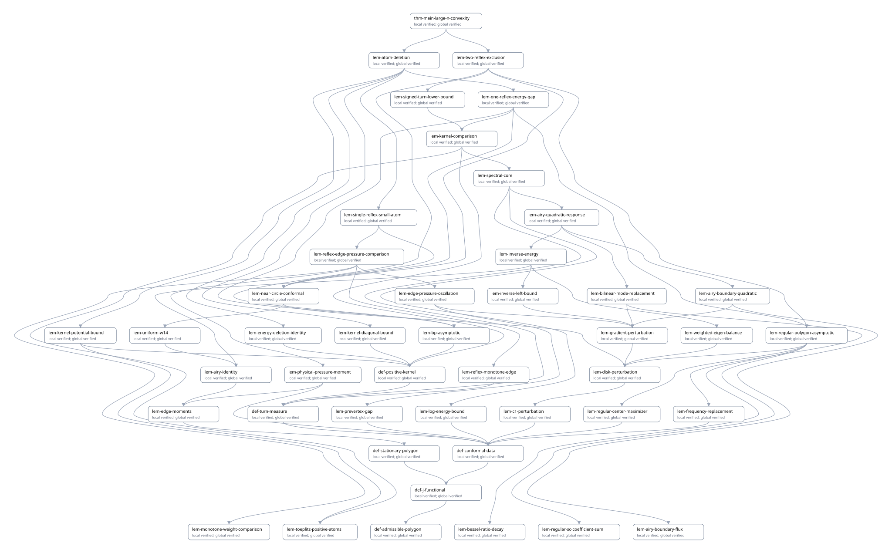

This page is generated by qmd-prover from the project's semantic QMD. Local verification is conditional on direct dependency statements; global status is computed from the complete dependency closure.

| Result | Local AI | Global | Refutation evidence | Source |
|---|---|---|---|---|
| @def-admissible-polygon | verified | verified | — | `workspace/large-n-proof.qmd:5` |
| @def-conformal-data | verified | verified | — | `workspace/large-n-proof.qmd:22` |
| @def-j-functional | verified | verified | — | `workspace/large-n-proof.qmd:9` |
| @def-positive-kernel | verified | verified | — | `workspace/large-n-proof.qmd:48` |
| @def-stationary-polygon | verified | verified | — | `workspace/large-n-proof.qmd:18` |
| @def-turn-measure | verified | verified | — | `workspace/large-n-proof.qmd:35` |
| @lem-airy-boundary-flux | verified | verified | — | `workspace/large-n-proof.qmd:597` |
| @lem-airy-boundary-quadratic | verified | verified | — | `workspace/large-n-proof.qmd:638` |
| @lem-airy-identity | verified | verified | — | `workspace/large-n-proof.qmd:76` |
| @lem-airy-quadratic-response | verified | verified | — | `workspace/large-n-proof.qmd:688` |
| @lem-atom-deletion | verified | verified | — | `workspace/large-n-proof.qmd:1201` |
| @lem-bessel-ratio-decay | verified | verified | — | `workspace/large-n-proof.qmd:888` |
| @lem-bilinear-mode-replacement | verified | verified | — | `workspace/large-n-proof.qmd:571` |
| @lem-bp-asymptotic | verified | verified | — | `workspace/large-n-proof.qmd:866` |
| @lem-c1-perturbation | verified | verified | — | `workspace/large-n-proof.qmd:113` |
| @lem-disk-perturbation | verified | verified | — | `workspace/large-n-proof.qmd:204` |
| @lem-edge-moments | verified | verified | — | `workspace/large-n-proof.qmd:61` |
| @lem-edge-pressure-oscillation | verified | verified | — | `workspace/large-n-proof.qmd:1042` |
| @lem-energy-deletion-identity | verified | verified | — | `workspace/large-n-proof.qmd:1229` |
| @lem-frequency-replacement | verified | verified | — | `workspace/large-n-proof.qmd:487` |
| @lem-gradient-perturbation | verified | verified | — | `workspace/large-n-proof.qmd:306` |
| @lem-inverse-energy | verified | verified | — | `workspace/large-n-proof.qmd:458` |
| @lem-inverse-left-bound | verified | verified | — | `workspace/large-n-proof.qmd:429` |
| @lem-kernel-comparison | verified | verified | — | `workspace/large-n-proof.qmd:822` |
| @lem-kernel-diagonal-bound | verified | verified | — | `workspace/large-n-proof.qmd:1317` |
| @lem-kernel-potential-bound | verified | verified | — | `workspace/large-n-proof.qmd:1279` |
| @lem-log-energy-bound | verified | verified | — | `workspace/large-n-proof.qmd:550` |
| @lem-monotone-weight-comparison | verified | verified | — | `workspace/large-n-proof.qmd:1116` |
| @lem-near-circle-conformal | verified | verified | — | `workspace/large-n-proof.qmd:282` |
| @lem-one-reflex-energy-gap | verified | verified | — | `workspace/large-n-proof.qmd:1259` |
| @lem-physical-pressure-moment | verified | verified | — | `workspace/large-n-proof.qmd:1096` |
| @lem-prevertex-gap | verified | verified | — | `workspace/large-n-proof.qmd:1024` |
| @lem-reflex-edge-pressure-comparison | verified | verified | — | `workspace/large-n-proof.qmd:1154` |
| @lem-reflex-monotone-edge | verified | verified | — | `workspace/large-n-proof.qmd:1070` |
| @lem-regular-center-maximizer | verified | verified | — | `workspace/large-n-proof.qmd:909` |
| @lem-regular-polygon-asymptotic | verified | verified | — | `workspace/large-n-proof.qmd:968` |
| @lem-regular-sc-coefficient-sum | verified | verified | — | `workspace/large-n-proof.qmd:925` |
| @lem-signed-turn-lower-bound | verified | verified | — | `workspace/large-n-proof.qmd:851` |
| @lem-single-reflex-small-atom | verified | verified | — | `workspace/large-n-proof.qmd:1179` |
| @lem-spectral-core | verified | verified | — | `workspace/large-n-proof.qmd:742` |
| @lem-toeplitz-positive-atoms | verified | verified | — | `workspace/large-n-proof.qmd:789` |
| @lem-two-reflex-exclusion | verified | verified | — | `workspace/large-n-proof.qmd:1000` |
| @lem-uniform-w14 | verified | verified | — | `workspace/large-n-proof.qmd:101` |
| @lem-weighted-eigen-balance | verified | verified | — | `workspace/large-n-proof.qmd:382` |
| @thm-main-large-n-convexity | verified | verified | — | `workspace/large-n-proof.qmd:1328` |

## Dependency graph

{fig-alt="A directed graph from results to the definitions and results cited by their proofs."}
